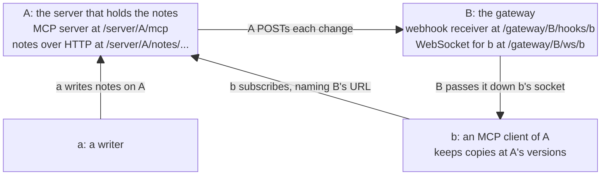

# Resource webhooks, standalone

**Status:** Pass 1 and Pass 2 drafted, 2026-10-25. Stage 1 ran twice and Larry settled what it raised; the mining pass ran; Pass 2's phases were written while Larry was away, with the calls that needed him marked as Claude's. Stage 2 comes next, then `/build-task`. The requirements level 2 implies are numbered in [sep-notes.md](../sep-notes.md).

## Objective

**Learn how best to build on MCP's core, its extensions API and SEP-3415, toward a specification in which an MCP client subscribes to some state (a resource), or a collection of them, with a webhook URL, and from then on the server POSTs to that webhook whenever one of them changes, carrying the resource's new contents, a patch to get to them, or a notification naming its new version.**

"Best" in the sentence above is a weighted value judgement, trading off technical feasibility, implementation elegance, and political viability to a potential sponsor, the core committee, and the MCP community at large.

**A prototype comes first because building is how we learn.** Some questions surface only when you try to implement. So where the design could raise one, as collections, catching up after a gap and resources outside `https` all could, the prototype takes it on rather than deferring it, and each answer it finds lands in `sep-notes.md` § *Findings*.

## Context

### Timing and political considerations

- **This is one of three possible flavors that we've identified so far, and the drafts are compared before one is recommended.** This one, the standalone flavor, has methods of its own, `resources/webhooks/subscribe` beside SEP-3415's `events/subscribe`. One that extends Events would add a second extension on Events' own methods. One that amends Events would change SEP-3415's own text, writing a state contract into it. The predecessor, `../mcp-events-prototype`, designed a state contract over Events' own methods, and its task files are this repo's mining source.
- **On 2026-10-14, Larry offered SEP-3415 a prototype of Open Question 2,** resource watching through events over a store that keeps every version, as an MIT-licensed package, and asked whether an event type could coalesce. Peter's answer is N1's. The prototype became this repo: Apache-2.0, because SEP-2133 requires it of an official extension, and a standalone extension rather than one built on events.
- **On SEP-3415's thread, on 2026-10-16, Larry argued that resources should stay inside Events.** Peter had written that morning that watching state and consuming messages "will need different handling and different APIs", that "we should likely share a bunch of the same machinery", and that the question "requires some thought and discussion". mib00038 proposed a contract declared per event type in `events/list`: `message`, where every occurrence matters, or `state`, where a server may send only the latest occurrence per key. Larry took that split up, wrote that if resources got a proposal of their own "we end up re-solving coalescing, resync, and deletion", and said his prototype would run `mcp.resource.updated` and `mcp.task.updated` as `state` types over Events' own methods, and report where the API had to diverge. Peter asked minutes later to move the discussion to the working group.
- **This flavor tests Peter's side of that question, so it is built first.** It gives resources methods of their own, and takes SEP-3415's webhook rules by reference: different APIs on the same machinery. SEP-3415's own rationale calls Events "a separate primitive" from resource watching, and the two mechanisms "independent". The flavors on Events' own methods, the one that extends it and the one that amends it, are the ones Larry described: his comment kept `state` inside SEP-3415, and on 2026-10-20 he was still asking Peter whether it belonged there or in a companion SEP. Built after this one and compared with it, they show where an API on Events' own methods has to diverge, which is the report Larry offered, and what coalescing, catching up and deletion cost each flavor.
- **Peter would rather extend `subscriptions/listen` than add a parallel `events/listen`.** On SEP-3415's thread, Felix Weinberger asked on 2026-10-22 whether Events could move its notifications to a method of its own, and Peter, posting as @poita, answered on 2026-10-23 that "introducing `events/listen` seems unnecessarily messy and inconsistent", asking instead that SEP-3371 let extensions add to `subscriptions/listen`.
- **The working group is now Tasks and Events,** renamed on 2026-10-16 by its charter's changelog and announced by Peter in Discord on 2026-10-21. The Agents working group becomes an interest group, its Tasks work folds in, and Luca Chang and Caitie McCaffrey join Clare Liguori and Peter as leads, "to allow us to figure how these things interact". Task state, the subject of Open Question 6, and resource state, this work's, now sit with one group.
- **The working group's charter is the product lens.** Its mission is to "define how servers proactively notify clients of state changes", "with defined ordering guarantees that hold across all transports", which level 2's per-URI version order meets. Its scope takes in SEPs on "delivery semantics, and event ordering guarantees", and leaves out modifications to `notifications/resources/updated` "that do not relate to proactive server-initiated delivery". Level 1 leaves that notification untouched, and level 2 is proactive delivery throughout. Its success criteria ask for "an accepted SEP defining the trigger/callback mechanism and its subscription lifecycle". `resources/webhooks/subscribe` is a second subscription lifecycle beside `events/subscribe`, a cost the comparison between flavors weighs.
- **SEP-3415 takes nothing new while its vote is pending.** Peter, in Discord on 2026-10-20: it is already judged big. The core maintainers may ask for changes after their review, which could give us another chance to comment on SEP-3415 itself.
- **Meanwhile, we start engaging the working group with a PR of proposals, not code,** to `modelcontextprotocol/experimental-ext-triggers-events`, as Luca's `proposals/XXXX-task-event-sources.md` is, opened once this prototype has taught us enough, so the group can comment on what we learned. The formal SEP follows, in `../modelcontextprotocol`, once SEP-3415 has landed and Peter is ready to sponsor it.
- **An Extensions Track SEP needs a reference implementation in an official SDK before review** (SEP-2133). This prototype is independent of the SDK, so that implementation comes later. No Events implementation is in the official TypeScript SDK yet (checked 2026-10-25), and Matt Carey's `typescript-sdk` #2820 adds the server and client extension mechanism it would use.

### Technical

- **SEP-3415's Open Question 2 is the floor for resources: the least a resource subscription over Events can be.** It asks whether resource subscriptions should be re-expressed as events, with "a reserved `mcp.resource.updated` event type whose arguments are `{uri}`", so that today's notification gains "cursors, poll and webhook delivery, and replay for free", and so that folding it in "would remove a parallel mechanism from the specification". Nothing in the sketch carries a value or a version: it is today's notification on Events' delivery. SEP-3415's rationale, in § *Relationship to existing primitives*, already allows it: "Servers MAY implement resource watching through events". Level 2's `notify` form carries the same news plus the version.
- **SEP-3415's rationale argues against extending resource subscriptions instead of adding `events/*`.** Resources "have no parameters or cursors", it says, and adding "filter arguments, replay and three delivery modes" to them "would distort that model". This extension leaves alone what the rationale protects: `resourceSubscriptions` and `notifications/resources/updated` are unchanged, and it adds a primitive beside them, as SEP-3415 did. A version is the representation's own `ETag`, an identity and not a position, and a collection's catch-up returns each member's newest state once (R32). Its change cursor, the nearest thing to what the rationale rejects, appears only in a collection's refresh results, never in a delivery, as § *Collections* shows.
- **Open Question 6 and Peter's comment open the way to more.** Open Question 6 sketches `mcp.task.updated` with the payload `{status, progress?, result?}`, which shows that an Events payload may carry state, result included. Peter's comment of 2026-10-16 ties the two cases together, "observing task state vs stream of messages", as needing different handling. Level 2 takes up that point, with deliveries that carry the value or a patch. We prove it on resources first, because a resource already has a URI and contents, where tasks bring in the Tasks extension. Luca Chang's Task Event Sources draft, `experimental-ext-triggers-events` #2, already ties a task to an Events stream that carries its intermediate results, and Luca is now one of the working group's leads.
- **Today a resource watcher needs an open stream.** `notifications/resources/updated` arrives only on a `subscriptions/listen` stream, since SEP-2575 replaced `resources/subscribe` with that stream's `resourceSubscriptions` filter. A change made while the stream is down is lost without a trace. Revisions 2025-03-26 to 2025-11-25 let a client resume an SSE stream with `Last-Event-ID`, but 2026-07-28 dropped that, and its server keeps no subscription state across reconnections. The notification also names only the URI, so acting on it takes another round trip via `resources/read`.
- **SEP-3371's extension points have a known gap for this work.** The Filesystems working group has reported that an extension's handlers cannot publish resource change events, and SEP-3371's draft itself says that triggers and events may need more APIs, for webhooks and long-lived streams among them. On SEP-3415's thread, Felix has since proposed opening `subscriptions/listen`'s filter to extensions, keyed by extension identifier, with SEP-3371 requiring SDKs to let an extension publish to the streams that opted in (2026-10-23).
- **Others are asking for the same pieces:**
  - SEP-3119 put the new contents in the notification. It was closed without a decision on 2026-09-22, and redirected to a working group first.
  - ext-tasks #24 asks for the current state on reconnect, for tasks.
  - The Filesystems working group's strawman (`experimental-ext-filesystems` #2) gives every resource an opaque `version`.
  - triggers-events #9 reports deliveries that are abandoned after their retries and lost without a signal.
  - triggers-events #10, a field report on evdock, describes a receiver for clients off the public internet: a relay on a Worker with a SQLite Durable Object that stores deliveries while its client is away, and never holds signing secrets. B, this design's gateway, makes the opposite choices: it holds its client's secret, stores nothing, and answers `503` while the client is away.
  - The Transports working group's drafts `transports-wg` #63 and #64 cover the authorization lifetime and lifecycle notifications of `subscriptions/listen` streams, missed notifications included, and #57, Definition Tags, gives results a `digest`.

The sections that follow say what makes this worth building, then show the first level end to end: MCP core as it is, plain HTTP, and `mcp.resource.updated` over Events. The second level comes after it, on the same cast, followed by collections, who may subscribe, the `patch` form, resources outside `https`, the wire types, what the extension takes from SEP-3415, and what building it should teach us. The subscriber is a client behind a gateway, the deployment most MCP clients need, since few can receive a webhook.

## Goals

1. **Show resource notifications working on top of SEP-3415's Events, cleanly, with the event type its Open Question 2 sketches.** This is not an important goal on its own. It comes first because it is what a sponsor can accept without argument, and the baseline level 2 is measured against.
2. **The most important goal is to learn whether resource state sync can be built elegantly without conflicting with Events.** Narrowing, elaborating, and extending Events in the ways it is meant to be extended are all expected. The aim is to break no requirement of Events, and where that proves impossible, or merely inelegant, to record it loudly in `sep-notes.md` § *Departures from SEP-3415*.
3. **Both levels follow SEP-3371's extension rules,** so an SDK that implements its extension points could host them as they are. SEP-3371's § *Extension rules* is about the wire, so this prototype checks it without an SDK: notifications use methods of the extension's own and add nothing to a core stream such as `subscriptions/listen`, any error code an extension allocates sits outside JSON-RPC's reserved range, and extra metadata on a core type goes in `_meta`. This extension allocates no codes (R29). A declares Events with an empty settings object, so level 1 sends nothing on `subscriptions/listen`, though SEP-3415 itself reserves a filter field there, `eventsListChanged`, which SEP-3371's rules leave out.
4. **A watcher hears about a change without holding a connection open.** Today it learns of one only while its `subscriptions/listen` stream is up.
5. **A missed delivery costs nothing once the next delivery for that resource arrives, in the `notify` and `full` forms, and at most one refresh interval otherwise,** an hour in the examples. Today a watcher that misses a notification cannot tell, and has nothing to catch up from.
6. **A delivery can carry the change itself.** Today a change takes two calls: the notification, which carries only the URI, and a `resources/read`.
7. **Webhooks work exactly as SEP-3415 defines them.** MCP keeps one webhook mechanism, an off-the-shelf Standard Webhooks verifier checks every delivery, and an SDK reuses its Events webhook code.
8. **It stays small.** The measure is how many requirements in `sep-notes.md` are this extension's own rather than references to SEP-3415.

## Relationships

- **Gated by nothing outside this repo.** The prototype and its notes can proceed now.
- **Before the PR, the prototype builds every phase in § *Phases*, in order:** level 1, then level 2 for one resource, collections, the demo page, the `patch` form and resources outside `https`, then the PR's proposals. That keeps the Objective's promise to take on what an implementation teaches rather than defer it.
- **The mining pass over the predecessor ran on 2026-10-25,** and gave each piece of its task files a fate. § *Phases* carries what it settled: the test oracle, the validator, the JSON-RPC core, the transport's details and the `patch` rules. The Lumenize port's notes now live in [lumenize-port.md](lumenize-port.md).
- **Mines and supersedes the predecessor's task files** at 79a927d, which stay untouched in `../mcp-events-prototype`. Nothing elsewhere waits on a test this repo un-skips.
- **Gates the PR** to `modelcontextprotocol/experimental-ext-triggers-events`, from the fork in `../experimental-ext-triggers-events` on its `resource-webhooks` branch.
- **Gates the official-SDK reference implementation,** in `../mcp-typescript-sdk`.
- **Gates the comparison** with the flavors that extend or amend Events.

## Current state

The predecessor, `../mcp-events-prototype`, never got as far as code, only design, in a few files including a detailed Pass 1 task file. Once we are happy with this repo's design, a mining pass over the predecessor decides each piece's final fate, but this draft already carries a number of items from it:

- the `Note` type, the tools `write_note` and `delete_note`, and the Worker's URL scheme
- the Events server that level 1 needs, cut to `events/list`, `events/subscribe`, `events/unsubscribe` and webhook delivery with its retries, as SEP-3415 defines them, with no replay
- the predecessor's cast, given new roles. Its peer that held the notes is now the server A, and its writing browser page is now `a`. Its peer that watched and kept copies has no counterpart: B is a gateway, and the client `b` behind it keeps the copies.
- the table of ways to reach a resource, and the plain-HTTP straw man with ETags as versions
- the forms `notify`, `full` and `patch`, and a delivery that names its own form
- coalescing to the newest version, and catching up from a version the client names
- a deletion delivered as a `notify` entry with a version of its own and `deleted: true`, with the subscription carrying on
- a collection's change cursor, which falls back to the whole collection when it is too old to serve

## Design intent

### Two levels on one cast

- **Level 1, the floor, is `mcp.resource.updated` over Events, as Open Question 2 sketches it.** It uses SEP-3415's own methods and an event type of that name, and adds nothing to either, so it adds no requirement to `sep-notes.md`. It shares A's webhook code with level 2, and with it N3, within SEP-3415's room. A declares `io.modelcontextprotocol/events` with an empty settings object, since it sends no list-change notifications. It takes the name Open Question 2 sketches, though SEP-3415 has yet to decide whether to reserve `mcp.*` names at all.
- **Level 2 is resource state sync, in this extension's own methods.** It keeps the cast, the gateway and SEP-3415's webhook rules, and changes what a delivery carries and how a subscriber catches up. Every requirement in `sep-notes.md` is for this level.
- **The demo runs them in that order,** so the second is always seen against the first. Between them, the page's Wipe button, which § *The cast* defines, empties all four parties, so level 2 starts from a clean slate, with nothing carried over from level 1 (Larry, 2026-10-23).
- **A's webhook code is built once, at level 1, and shared.** Level 2 composes it with a coalescing queue per subscription and URI, and its own body. The prototype builds SEP-3415's MUSTs and whatever the demo shows. Suspension, dual-signing during a secret's rotation, `deliveryStatus`, which SEP-3415 lets a server omit, and the three ways to verify an endpoint besides the handshake wait until something needs them.

### The cast

Four parties: a server and a gateway defined in one Worker project, and two clients running on the user's own machine, each in a browser or in some other runtime, a "script".



- **Changes flow from `a` to A to B to `b`:**
  - **From `a` up to A by any means a server offers:** an MCP tool call, an HTTP `PUT` or `POST`, a file write, stdio. The demo starts with A's `write_note` tool, in Scenario 1a, and uses `PUT` in Scenario 1b's plain-HTTP baseline.
  - **From A across to B by webhook:** an Events occurrence at level 1, and at level 2 a change in one of three forms. `notify` names the new version, `full` adds the contents, and `patch` carries a merge patch from the previous version.
  - **From B down to `b` by a channel neither SEP specifies:** a WebSocket here, though stdio, a CLI or anything else would do.
- **`b` subscribes with A directly, which is SEP-3415's forward-proxy deployment.** `b` calls A, naming B's webhook URL as the place to deliver, since in SEP-3415 "the callback URL does not need to be the client itself". This example hosts B in the same Worker project as A, which a real forward-proxy deployment would not.
- **The Worker** at `https://resource-webhooks-standalone.transformation.workers.dev`, a provisional name until the first deploy, hosts both A and B, and `...` stands for it in the examples. Each later flavor of this SEP, if we build them, gets a Worker project of its own, named after its repo, so each deploys alone. Its `compatibility_flags` include `global_fetch_strictly_public`, so A's webhook POST to B, on the Worker's own host, goes out and comes back through Cloudflare's front door, as a POST to any receiver would. Cloudflare's docs say that without the flag the fetch fails with error 1042, but a Lumenize measurement saw a Durable Object reach its own workers.dev URL without it, so phase 5 measures A's case.
- **A and B are Durable Object classes of their own, `Server` and `Gateway`.** Each composes a module that holds its role, so the Lumenize port can compose the same modules into a Lumenize node, as Lumenize composes its `ClientGateway` into the scoped node that hosts it. The `Server` role takes a parsed message and a verified principal, with `sql`, `send(url, headers, rawBody)` and `waitUntil` passed in. The `Gateway` role takes a delivery's headers and raw bytes, since SEP-3415 signs the bytes as received, and returns a status, with `secretFor(client)` and `forward(client, message)` passed in. A check fails if a role module touches `Request`, `WebSocket`, `DurableObjectState`, `cloudflare:workers` or the global `fetch`.
- **The Worker routes with a copy of `routeDORequest`, in `src/vendor/lumenize-routing/`.** It is copied from `@lumenize/routing`, six files and about 790 lines, with its `@lumenize/debug` logging removed, relicensed under Apache-2.0 and listed in `ATTRIBUTIONS.md`. The Worker imports it by relative path, so its `fetch` handler reads as the Lumenize port's would, and passes it four options, which the route table below applies:
  - **`bindings`,** so a path such as `/server/A/...` or `/gateway/B/...` can reach only a `Server` or a `Gateway`.
  - **`cors`, naming one allowed origin per environment,** a constant never computed from the request: the deployed Worker's own, `http://localhost:8788` for the conformance suite's local run, since its DNS-rebinding check sends the origin with its port, and `https://localhost:<port>` for the browser test. A deployed Worker never allows an `http://` origin. A request whose `Origin` is present and not that origin is refused with `403` before any object wakes, as MCP's Streamable HTTP transport requires: servers "MUST validate the `Origin` header on all incoming connections to prevent DNS rebinding attacks". A request with no `Origin`, such as A's webhook POST to B, passes. The check covers B's socket too, since `routeDORequest` runs it before either hook. `applyCorsPolicy` answers a preflight `OPTIONS` from another origin with `204` and no CORS headers, so the Worker, not the vendored copy, turns that into `403` on every route, as the transport requires.
  - **`onBeforeRequest`, checking A's tokens at the edge,** as § *Who may subscribe* says.
  - **`onBeforeConnect`, checking `b`'s token for B's socket,** as § *The leg between the gateway and its client* says.
- **One table holds every route, and the edge denies by default.** `onBeforeRequest` and `onBeforeConnect` see every request and every upgrade, so each decides by the path, as the last column says, before any stub is made. A path naming any instance but A under `/server` or B under `/gateway` answers `404`, as does a path the table does not list, and a bare `/server` with no instance, while a method the table does not list for a path it does answers `405` with `Allow`, as a `GET` of A's MCP endpoint does. After it verifies a token, the edge sets the token's claims in a header, `x-rw-principal`, as `{"sub":"…","epoch":0}`, and strips that header from every request before it. The Worker serves its static assets with no `not_found_handling`, so a browser's navigation to `/authorize` or to a note, which matches no asset, reaches the Worker, where a fallback page would answer it first. The authorization server's routes are the ones `routeDORequest` does not match, and the Worker hands them to A by hand, after the same `Origin` check, `applyCorsPolicy`, which the copy exports.

| Path | Request | Handled by | Needs |
|---|---|---|---|
| `/` and the page's assets | `GET` | the Worker's static assets | nothing |
| `/server/A/mcp` | `POST` | A | a token for A |
| `/server/A/notes/...` | `GET` | A | nothing |
| `/server/A/notes/...` | `PUT`, `DELETE` | A | a token for A |
| `/server/A/page` | WebSocket | A, the page's back channel | nothing |
| `/gateway/B/hooks/{client}` | `POST`, from A | B | a valid signature, which B checks |
| `/gateway/B/ws/{client}` | WebSocket | B | a token for B's socket, issued to that client |
| `/gateway/B/page` | WebSocket | B, the page's back channel | nothing |
| `/register`, `/authorize`, `/token`, `/.well-known/...` | as OAuth defines them | A, by hand | nothing |

- **A holds notes and lists.** Each one is an `https` resource, such as `.../server/A/notes/inbox/note-42`, which a client can read with `resources/read` or a plain `GET`, and which carries an `ETag` per version. Notes change through A's tools, `write_note` and `delete_note`, or by `PUT` and `DELETE` on their URLs. `write_note` takes an optional `version` that refuses a stale write, as `If-Match` does, and returns the new version (Claude, 2026-10-25, while Larry was away). Every write is checked against JSON Schema generated from `Note` or `List`, both closed, so a member that is `null` or unknown is refused. A also runs the authorization server that `b` gets its tokens from, in a module of its own beside A's server module, so A's role module sees only verified claims.
  - **A serves its folders and types as collections.** A `resources/read` of `.../server/A/notes/inbox` or `.../server/A/notes` returns one entry in `contents` per note under it, and a plain `GET` of a folder returns its members' URIs with no `ETag`, since a collection has no version (Claude, 2026-10-25, while Larry was away). Folders nest to any depth, and A tells a note from a folder by the last segment: a segment that starts with the type's singular and a hyphen, such as `note-42` or `list-7`, names a resource, and the writer mints the rest, as a ULID in practice. Anything else names a folder.
  - **A's core MCP methods are the ones the scenarios use:** `server/discover`, `tools/list`, `tools/call`, `resources/read`, `resources/list` and `resources/templates/list`. A read of a resource a client may subscribe to answers `ttlMs: 0`, so no cache serves a read older than the version a delivery named.
  - **`resources/templates/list` returns one template per type,** so each can describe its type, with reserved expansion, `{+path}`, which may span segments (Larry, 2026-10-25):

    ```jsonc
    { "resourceTemplates": [
      { "uriTemplate": ".../server/A/notes/{+path}", "name": "notes",
        "description": "A note, { title, done?, due? }, or a folder of notes",
        "mimeType": "application/json" },
      { "uriTemplate": ".../server/A/lists/{+path}", "name": "lists",
        "description": "A list, { title, items }, or a folder of lists",
        "mimeType": "application/json" } ] }
    ```

    Every entry a read under a template returns is a JSON note or list, so each template can carry one `mimeType`. A type's root, as `.../server/A/notes`, is a collection A serves that neither template matches, since `{+path}` needs at least one character.
  - **`resources/list` returns the inbox's notes and every list,** so a `listed` target covers more than the inbox does, and an archived note is reachable only through a template.
  - **A keeps every version of each resource, as rows stamped from one counter across A** (Larry, 2026-10-25). A change adds a row, and a deletion adds one marked deleted, as Lumenize's temporal model keeps a row per version and one for a deletion. The one counter across A is this design's: Lumenize's `validFrom` orders each resource on its own. A version is the row's stamp under the epoch, as `e2.17`, so no version is ever reused for a URI, and the examples write short per-resource labels, `v1` and `v2`, for reading. Scenario 10's rows after the cursor `c1` are:

    | Stamp | Resource | Version | Deleted |
    |---|---|---|---|
    | `c2` | note-43 | `v1` | |
    | `c3` | note-43 | `v2` | |
    | `c4` | note-43 | `v3` | |
    | `c5` | note-44 | `v1` | |
    | `c6` | note-43 | `v4` | yes |

    A cursor is a stamp. A collection's catch-up from `c1` reads each resource's newest row past it, `c6` and `c5`, and a patch reads the row of the version a client names. The stamp is SQLite's rowid, with each insert made before any pruning in one synchronous block, so a pruned top row never lends its stamp to the next write, at no write beyond the row itself. Rows hold paths relative to A's root, such as `/notes/inbox/note-42`, and a folder's members are a range on them, `path >= '/notes/inbox/' AND path < '/notes/inbox0'`, since DO SQLite refuses a `LIKE` pattern over 50 bytes. A body over 1 MiB is refused with `413`, well under SQLite's 2 MB row limit. Subscriptions sit in a table keyed `(targetKind, target, principal, url)` `WITHOUT ROWID`, so a write finds the subscriptions covering a URI by its key, and a refresh is one write. A drops rows older than its cut-off window as it writes, with no alarm, a setting of A's, a day by default, which the tests shorten to reach a reset, but keeps each live resource's newest row. It expires a subscription the same way, checking its grant lazily at delivery and sweeping expired ones when it wakes. A tells that a cursor is older than the rows it dropped with no write: stamps are dense, so when fewer rows lie past the cursor than the newest stamp less the cursor, a row past it was dropped, and the cursor gets a reset.
  - **A list is the second type,** `{ "title": "Groceries", "items": ["oat milk"] }`, so that a template can match across types.
- **B is a gateway, and stores nothing.** It receives webhooks for each of its clients at a URL of that client's own, `/gateway/B/hooks/{client}`, the path shape SEP-3415's own examples use, and passes each one down that client's WebSocket. Each socket carries its client's secret in its attachment, so B writes nothing, as Lumenize's Gateway writes nothing. B never calls A, and holds no principal there.
  - **SEP-3415 uses both words, gateway and forward proxy, sometimes in one paragraph,** as Appendix A's webhook mode does. This design says gateway. Unlike the proxy of § *Webhook-Based Delivery*, which serves events to its clients by poll or push and so buffers them, B passes each delivery straight down its client's socket and keeps none. Lumenize's Gateway also carries a client's calls up to the nodes, and this one carries only deliveries down, since `b` calls A itself.
  - **Nothing in B knows about notes,** and the same gateway serves both levels, since an Events occurrence and a level-2 change arrive with the same headers, signatures and verification.
- **`b` is an MCP client of A that cannot receive a webhook,** as Claude Code on a laptop or a browser tab cannot. It holds the token, subscribes, refreshes, and keeps a copy of each resource it watches, at A's version. It can be a script in the early phases, but for the demo it runs in the browser, so its own messages are recorded where the demo shows them.
- **The demo shows every message, and what each party holds.** `a` and `b` run in the browser, so their records are local to the page. A and B run on Cloudflare, so they report their contents and the messages they send and receive to the page via a WebSocket back channel. Reports are redacted at the source: a secret shows as `whsec_…(32 bytes)`, a token as its `sub` and `aud`, and a signature as `verified` or `failed`, and a control message is never reported.
- **The page has two controls of its own so far, outside both SEPs,** sent to A and B over the same back channel. Larry has rehearsed the first beats, which brought in the Wipe, and the page's other controls wait for rehearsal after the build (Larry, 2026-10-25). The controls need an operator token, held as a Worker secret, and every control is refused when that binding is absent, with no separate deployed mode: local runs supply it in `.dev.vars`, and vitest in miniflare's `bindings`. Larry types the token into the page, which keeps it in `sessionStorage`, never in its assets or a URL, and A and B compare it in constant time and never report it. The back channel's reports stay open to the page (Claude, 2026-10-25, while Larry was away):
  - **The Wipe button empties all four parties between the levels.** A loses its notes, subscriptions, verification cache and pending retries, and raises its epoch, which the Wipe never deletes, so it refuses every token and client registration issued before. B closes its sockets. `a` and `b` register with A again, and `b` drops its copies, gets a new token for B's socket, reconnects to B and registers a new secret. An old token for B's socket still opens one, but its client id is no longer registered, so it receives only what someone subscribes it to. The page clears the messages it shows.
  - **A's retry schedule,** shown on screen, clamped to SEP-3415's bounds of 3 to 5 attempts over at most 15 minutes: those bounds by default, and in the demo three attempts at 2, 4 and 8 seconds, so the audience sees a retry, and a newer version replacing a pending one, as they happen.
- **Versions behave as HTTP's `ETag`s do.** A version is the resource's strong `ETag`, written without its quotes: `v2` on this extension's wire, `"v2"` in an HTTP header. Clients compare versions only for equality. A's versions need not sort in time, though they may, and a server that knows its own versions sort MAY rely on that inside its implementation. In the examples they are short strings, `v1` and `v2`, and each level's examples count from `v1`. A's versions never repeat across a Wipe, since A mints them under its epoch, a count of Wipes, as `e2.v1`, and the page shows the short form.

```ts
interface Note { title: string; done?: boolean; due?: string; }
interface List { title: string; items: string[]; }
```

### The leg between the gateway and its client

Neither SEP-3415 nor this extension says how a gateway reaches its client. SEP-3415 says only that the endpoint passes on what it receives "by whatever channel it uses". This prototype uses a WebSocket, since Durable Objects hold them cheaply. Stdio, or anything else that carries a message each way, would do.

1. **`b` registers its secret first, on every connection,** with `{"secret": "whsec_..."}`, and B keeps it in the socket's attachment while the socket is open, then acknowledges it on the socket. `b` waits for that before it subscribes or refreshes, because A's verification challenge arrives at B while A is still handling the subscribe call. B answers that challenge itself, at once, from the secret it holds, without asking `b`.
2. **B passes on each delivery whose signature verifies and whose `webhook-timestamp` is within five minutes, answers `401` to one that fails either, and answers A straight away.** It passes `{subscriptionId, webhookId, body}`, so `b` drops a `webhook-id` it has seen and a change none of its targets covers (Claude, 2026-10-25, while Larry was away). A send on a WebSocket does not wait for `b`, so B holds nothing while it answers. While `b`'s socket is closed, or quiet past its heartbeat, B answers `503`, one of the retryable answers SEP-3415 names for a receiver that is not ready.
3. **The socket stays honest about `b`.** `b` pings every 30 seconds and B answers with `setWebSocketAutoResponse`, so B can treat a socket whose last ping is two intervals old as closed, as a sleeping laptop leaves it. On a reconnect B closes the client's older sockets, as Lumenize's `ClientGateway` does, and it closes a socket with `4401` when its token expires. Each socket is accepted with `ctx.acceptWebSocket` and tagged, as `client:b` or `page`. `b`'s token rides as a subprotocol entry, `rw.token.<token>`, beside `rw.1`, which B echoes, since a browser cannot set `Authorization` on an upgrade and a query string would reach logs.
4. **B tracks nothing else.** A client that reconnects refreshes each of its subscriptions, so B never needs to know what it missed.
5. **Who may connect is B's own business,** as it is any gateway's, and here B checks a token, in `routeDORequest`'s `onBeforeConnect`. The socket's path, `/gateway/B/ws/b`, names the client by its OAuth client id, as Lumenize's Gateway takes a client's id from its path. `b` gets a second token from A's authorization server, by one more pass through its instant consent, with B's socket URL as its only audience, so neither of `b`'s tokens works where the other does. `onBeforeConnect` checks the token's signature, expiry and audience, and that the path names the client it was issued to. B trusts A's authorization server only because both run in one Worker, and a gateway of a client's own would trust its own issuer. The page's back channel, which is the demo's and outside both SEPs, passes unchecked, though a control sent over it needs the operator token.

### Four ways to reach a resource

| | MCP core, 2026-07-28 | Plain HTTP | Events, with Open Question 2's type | This extension |
|---|---|---|---|---|
| **Write** | `tools/call` on a tool the server offers, such as `write_note` | `PUT` on the resource's URL, and `DELETE` | (none) | (none) |
| **Read** | `resources/read` | `GET` on the resource's URL | (none) | (none: a client reads with `resources/read` or `GET`, though a `full` subscription's result also carries the contents) |
| **Poll for changes** | `resources/read` on a cadence, which returns the whole contents every time, with nothing to say whether they changed | a conditional `GET` with `If-None-Match`, answered `304 Not Modified` when nothing changed | `events/poll` with a cursor, which level 1 leaves out | (none, for now) |
| **Be told of changes** | `notifications/resources/updated` on an open `subscriptions/listen` stream, naming only the URI | (none) | a webhook POST naming the URI | a webhook POST with the new version, and the contents or a patch if asked for |

Level 1 takes the first three columns, in Scenarios 1a, 1b and 2. Level 2 takes the last, from Scenario 3 on.

### Cursors, versions and IDs

Several values in SEP-3415 and this design look alike: opaque strings a client is handed, keeps, and sometimes sends back. They come in two kinds. A position is a place in an order of changes, and only the server reads it. An identity names one thing, and anyone may compare two for equality.

| Value | What it names | What uses it, and how | In this design |
|---|---|---|---|
| SEP-3415's `cursor`, as `cursor_0042` | A position in an event type's stream. In webhook mode it is the watermark. | The client keeps the last one it got and sends it on a refresh, and the server replays from there. `null` means start from now. | Level 1 sends `null` and gets `null` back, since A offers no replay. |
| `eventId`, as `evt_0042` | An identity: one upstream event, the same on every subscription it matches. | The client drops a second copy that arrives on the same subscription. | Level 1's occurrences. |
| `webhook-id`, as `msg_2Lq8…` | An identity: one delivered message, the same on every retry of it. | The receiver drops a retry it already accepted. | Both levels (R14). |
| The subscription `id`, as `sub_a3f1…` | An identity: one subscription, derived from its key. | The receiver reads it from `X-MCP-Subscription-Id` to pick the secret that verifies a delivery. | Both levels (R25). |
| `version`, as `v2` | An identity: one state of one resource, its `ETag` (§ *The cast*). | In HTTP, a client sends it in `If-None-Match` on a `GET`, answered `304 Not Modified` while it is current, and in `If-Match` on a `PUT`, refused with `412 Precondition Failed` if someone else wrote first. Here, a client names the version it holds on a refresh, and ignores a delivery of one it holds. | Level 2, and the `ETag` of Scenario 1b. |
| A change cursor, as `c1` | A position in the order of one collection's changes. | The client sends the one from its last refresh, and gets the members changed since. | A collection's refresh, in § *Collections*. |

- **The watermark lags because webhook deliveries overlap.** A posts each event as it happens and retries each on its own, so deliveries can land out of order. Say events 41, 42 and 43 go out, and 42's first attempt fails while 41 and 43 succeed. If 43's delivery carried `cursor_0043`, a client that kept it and later replayed from it would never get 42. So it carries `cursor_0041`, and only a delivery or refresh after 42 is accepted, or abandoned, carries `cursor_0043`. Poll and push hand out events in order, so there the cursor after an event is that event's own position.
- **Each subscription has its own watermark,** because each has its own deliveries in flight. If a second subscriber's receiver took 42 the first time, its delivery of 43 already carries `cursor_0043`. SEP-3415 has the server hold, per subscription, the position and acceptance of each event in flight. That state is in memory, and after a restart the client's refresh, naming the cursor it kept, rebuilds it.
- **The paging cursor is a different thing again.** MCP's list methods, such as `resources/list`, return `nextCursor` when a result runs to more than one page, and the client sends it back as `cursor` for the next page. It is a position in one listing, not in any order of changes, so it tells a client nothing about what changed between two reads. A collection's catch-up pages with its change cursor instead, as § *Collections* shows.

### Level 1: `mcp.resource.updated` over Events

#### Scenario 1a: MCP core as it is

`a` writes a note through A's tool, since MCP resources have no write method, and `b` reads it:

```jsonc
// a → A, POST /server/A/mcp
{ "jsonrpc": "2.0", "id": 3, "method": "tools/call",
  "params": { "name": "write_note",
    "arguments": { "uri": ".../server/A/notes/inbox/note-42",
                   "note": { "title": "Buy milk" } } } }

// b → A, POST /server/A/mcp
{ "jsonrpc": "2.0", "id": 4, "method": "resources/read",
  "params": { "uri": ".../server/A/notes/inbox/note-42" } }
// A → b
{ "resultType": "complete",
  "contents": [ { "uri": ".../server/A/notes/inbox/note-42",
                  "mimeType": "application/json",
                  "text": "{\"title\":\"Buy milk\"}" } ],
  "ttlMs": 0, "cacheScope": "public" }      // read again whenever it matters
```

- **Nothing in the result names a version,** so `b` cannot tell whether a later read returns the same note or a new one without comparing contents. The phase on resources outside `https` adds one, under a `_meta` key, to every read A serves.
- **To hear about the next change, `b` would hold a `subscriptions/listen` stream open** with the note in its `resourceSubscriptions`. Holding a stream is what this work avoids, so the demo skips it.

#### Scenario 1b: polling with plain HTTP

This scenario uses no MCP at all. It shows what an `https` resource can do already, and where versions come from. `a` writes, and any client polls.

```http
GET /server/A/notes/inbox/note-42      → 200, ETag: "v1"
                                         {"title":"Buy milk"}
GET /server/A/notes/inbox/note-42      → 304 Not Modified
If-None-Match: "v1"
PUT /server/A/notes/inbox/note-42      → 204, ETag: "v2"   (a, the writer)
If-Match: "v1"
Authorization: Bearer <a's token for A>
{"title":"Buy milk","due":"2026-10-24"}
GET /server/A/notes/inbox/note-42      → 200, ETag: "v2"
If-None-Match: "v1"                      {"title":"Buy milk","due":"2026-10-24"}
```

- **Here the version travels as HTTP writes an `ETag`,** quoted, as `"v2"`, where this extension's own wire writes `v2`.
- **Polling is solved for `https` resources,** which is why this extension leaves polling out, for now. Without some way to push, it either polls often or learns late.
- **A write follows RFC 9110.** A `PUT` under `If-None-Match: *` creates a note, answering `201` with its `ETag`. One under `If-Match` replaces it, answering `204` with the new `ETag`, or `412` when the version is stale. A `GET` of a deleted note answers `404`.
- **Plain HTTP cannot watch a folder.** Polling note-42 never reveals a new note-43, and a folder's `GET` carries no `ETag`, so a client watching the inbox fetches the whole list each time.

#### Scenario 2: `mcp.resource.updated` over Events

A lists the type in `events/list`, as Open Question 2 sketches it, carrying in `data` what today's notification carries, the URI:

```jsonc
{ "name": "mcp.resource.updated",
  "description": "A resource changed",
  "delivery": ["webhook"],
  "inputSchema": { "type": "object", "required": ["uri"],
                   "properties": { "uri": { "type": "string" } },
                   "additionalProperties": false },
  "payloadSchema": { "type": "object", "required": ["uri"],
                     "properties": { "uri": { "type": "string" } } } }
```

`b` registers a secret with B, as § *The leg between the gateway and its client* says, then subscribes with SEP-3415's own method:

```jsonc
// b → A, POST /server/A/mcp
{ "jsonrpc": "2.0", "id": 5, "method": "events/subscribe",
  "params": {
    "name": "mcp.resource.updated",
    "arguments": { "uri": ".../server/A/notes/inbox/note-42" },
    "delivery": { "mode": "webhook", "url": ".../gateway/B/hooks/b",
                  "secret": "whsec_<base64 of 32 random bytes>" },
    "cursor": null,                       // start from now
    "ttlMs": 3600000 } }
// A → b, after SEP-3415's verification handshake with B
{ "resultType": "complete", "id": "sub_7c2e91d04ab35f68",
  "refreshBefore": "2026-10-21T15:00:00Z",
  "cursor": null, "truncated": false }   // A offers no replay
```

`a` marks the note done through `write_note`. A POSTs an ordinary occurrence to B, with SEP-3415's signed headers, and B passes it down `b`'s socket:

```jsonc
{ "eventId": "evt_0042", "name": "mcp.resource.updated",
  "timestamp": "2026-10-21T14:05:00Z",
  "data": { "uri": ".../server/A/notes/inbox/note-42" },
  "cursor": null }
```

`b` then reads the note with `resources/read`, as in Scenario 1a.

- **Nothing here is new.** It is SEP-3415's methods and webhook rules, an event type named as Open Question 2 sketches it, and B as the gateway in SEP-3415's forward-proxy deployment. That is Goal 1.
- **Each change costs two round trips,** the notification and the read, and the notification says only that something changed.
- **After an absence, `b` cannot tell what it missed.** A offers no replay, which SEP-3415 allows, so its cursors are `null` and a refresh restarts delivery from now. `b` re-reads every note it cares about.
- **A offers no replay, by choice.** A's store of versions (§ *The cast*) holds what a replay of this type would send, one occurrence per version. What replay would add is a watermark for each subscription, as § *Cursors, versions and IDs* shows, and a payload of every step: for note-43's four changes in Scenario 10, four occurrences, each followed by a read, where level 2 sends the one newest version. State-sync services keep no watermark either, because the client's cursor comes from its own call: Dropbox's notification names only the account, and the app calls `files/list_folder/continue` with the cursor it stored.

Level 2 removes the second read and the blind spot after an absence, without a watermark for each subscription.

### Level 2: resource state sync

#### Only the newest version matters

A resource is state, and a watcher wants to hold its newest version, not to witness every change. This is perhaps the biggest mental model difference from the Events SEP. Three edits while a receiver is down leave it needing only the third. These things follow:

- **The server may coalesce.** A delivery still pending when a newer version lands is replaced by it, and a lost delivery is repaired by the next one for the same URI.
- **Nothing in the design replays changes** (Larry, 2026-10-25). A client needs a resource's newest version, not the steps that led to it, so every catch-up reads each resource's newest version past what the client holds, from A's store of versions (§ *The cast*).
- **One resource needs only versions,** never a cursor, since a version already says which state a client holds (§ *Cursors, versions and IDs*). A collection's catch-up adds a change cursor, as § *Collections* shows.
- **The server never stores a delivery position per subscription** (Larry, 2026-10-21). A subscription's record is written when it is created and when it is refreshed, and § *Decisions* gives the reasons.
- **Retry queue status per subscription is kept in memory, not storage.**
  - **What it holds:** for each subscription and URI, the pending version, its attempts so far, and in the `patch` form the version its patch starts from. Coalescing keeps that to one entry.
  - **How long it runs:** a few attempts with backoff over no more than 10 to 15 minutes, as SEP-3415 bounds them, which puts it with Slack's and Dropbox's short retries. Each entry's retry loop runs under `ctx.waitUntil`, which from compatibility date 2026-10-01 holds a Durable Object up to 15 minutes from the promise's start, capped at about 14 minutes from the first attempt, so retries need no alarm and no write. A bare timer must not be what holds them: of 14 timers Lumenize measured awaiting 240 seconds, 13 held the object and one was evicted at 120 seconds, as its `durable-objects.md` records.
  - **What a 2xx clears.** Each entry has two states, pending and in flight. A `2xx` clears only the version it answers, then sends whatever is pending, and the store's precondition, its insert and the queue's update run in one synchronous block, with signing and sending after it.
  - **What a handshake must not lose.** The handshake is a fetch, which opens A's input gate, so once it succeeds A writes the subscription row and reads the version, contents or cursor in one synchronous block.
  - **What repairs a drop:** a delivery whose retries run out, or that an eviction or restart drops, is repaired at the subscriber's next refresh. A webhook POST wakes a hibernating gateway, so B rarely misses one. A client behind a gateway misses more when it sleeps, and catches up by refreshing when it reconnects.
  - **The schedule is a setting of A's,** which the page sets for the demo, as § *The cast* says.
- **A refresh is the catch-up:** the subscriber's own call repairs any number of misses, as Scenarios 5 and 7 show. What its result carries is the caller's choice each time, by `catchUp`, independent of the subscription's form (Larry, 2026-10-25). `notify`, the default, names the current version, `full` adds the contents, and `patch` sends a patch from the version the caller names. So a `notify` subscriber can still ask for a patch when it reconnects, and A's catch-up never depends on a subscription's form. A refresh result and a delivery can cross, since one comes back on the HTTP response and the other through B's socket, so a client that receives a delivery for a URI while a refresh naming it is outstanding refreshes again once the result arrives (R41) (Claude, 2026-10-25, while Larry was away).

#### Scenario 3: a first subscription, from nothing

*In sep-notes.md: R5, R8 and R22.*

At 15:00, after the Wipe, `a` writes note-42 again, as `v1`. `b` connects to B at `wss://.../gateway/B/ws/b`, registers a secret, and subscribes in the `full` form, holding nothing, asking for the contents in the result too:

```jsonc
// b → B, first, over b's WebSocket: this prototype's own message
{ "secret": "whsec_<base64 of 32 random bytes>" }

// b → A, POST /server/A/mcp
{ "jsonrpc": "2.0", "id": 7, "method": "resources/webhooks/subscribe",
  "params": {
    "uri": ".../server/A/notes/inbox/note-42",
    "form": "full",            // the contents in each delivery; notify if omitted
    "catchUp": "full",         // and in this result
    "delivery": {
      "url": ".../gateway/B/hooks/b",       // B's URL for b, not b's own
      "secret": "whsec_<the same secret>" },
    "ttlMs": 3600000 } }       // no version: b holds none yet
```

Before answering, A verifies that the webhook URL wants deliveries, by SEP-3415's handshake. It POSTs `{"type":"verification","challenge":"<nonce>"}` to B, signed with `b`'s secret. B checks the signature against the secret `b` registered, and echoes the challenge.

```jsonc
// A → b, the result
{ "resultType": "complete",
  "id": "sub_a3f1c8e2b0d49f7e",              // stable for (principal, url, uri)
  "refreshBefore": "2026-10-21T16:00:00Z",   // the grant; refresh before it
  "version": "v1",
  "contents": [ { "uri": ".../server/A/notes/inbox/note-42",
                  "mimeType": "application/json",
                  "text": "{\"title\":\"Buy milk\"}" } ] }
```

- **The result is `b`'s first copy.** It names `v1` and carries the contents, since the request asked for them, so one call both subscribes and reads. In level 1, `b` subscribed and then read, and the read named no version.
- **`b` holds nothing until this result arrives,** which is why its request names no version.

#### Scenario 4: a change it hears about

*In sep-notes.md: R10, R14, R15 and R30.*

At 15:05, `a` marks the note done, making `v2`. A POSTs to B:

```http
POST /gateway/B/hooks/b
Content-Type: application/json
webhook-id: msg_2Lq8vT0cXwR4mB7nYp3sKe6dJf1
webhook-timestamp: 1792595100
webhook-signature: v1,<base64 HMAC-SHA256 over id, timestamp and body>
X-MCP-Subscription-Id: sub_a3f1c8e2b0d49f7e

{"uri":".../server/A/notes/inbox/note-42","form":"full","version":"v2",
 "contents":[{"uri":".../server/A/notes/inbox/note-42",
   "mimeType":"application/json","text":"{\"title\":\"Buy milk\",\"done\":true}"}]}
```

B verifies the signature, passes the body down `b`'s socket as it was, then answers `200`, and `b` replaces its copy with `v2`.

- **The headers and the signature are SEP-3415's,** so B checks them with an off-the-shelf Standard Webhooks verifier. `webhook-id` is the same for every retry of one version of one URI, so a receiver that deduplicates on it drops repeats (R14).
- **B answers only after passing the delivery on,** as SEP-3415 asks an endpoint to accept a delivery only once it has persisted or forwarded it.
- **In the default `notify` form, the same delivery carries only the version,** as `{"uri": ..., "form": "notify", "version": "v2"}`, and `b` fetches the note when it wants it, with `If-None-Match: "v1"`. That is the same news as level 1's occurrence plus one field, the version, and the field lets `b` skip a read whenever the version is one it already holds, which makes every delivery safe to repeat.

#### Scenario 5: a refresh before the grant runs out

*In sep-notes.md: R6 and R15.*

A refresh is the same subscribe call, made again with the same `uri` and `delivery.url`. SEP-3415 asks a subscriber to make it before `refreshBefore`, and the grant then starts again. It may also change the form and rotate the secret. `b` names the version it holds:

```jsonc
// b → A, at 15:20, before the 16:00 grant runs out
"params": { "uri": ".../server/A/notes/inbox/note-42", "form": "full",
            "catchUp": "full", "version": "v2",
            "delivery": { "url": ".../gateway/B/hooks/b", "secret": "whsec_..." } }
// A → b
{ "resultType": "complete", "id": "sub_a3f1c8e2b0d49f7e",
  "refreshBefore": "2026-10-21T16:20:00Z",
  "version": "v2" }                          // equal to b's: no contents, no news
```

- **A refresh is neither a push nor a read.** It is the subscriber's own call, it extends the subscription, and its result says what is current, with the contents only when the subscriber's version differs and it asked for them. Scenario 7 shows that case.
- **A subscriber may refresh whenever it suspects it missed something,** not only when a grant is running out. `b` refreshes every subscription when it reconnects to B.

#### Scenario 6: changes it never sees

*In sep-notes.md: R12 and R13.*

`b`'s laptop sleeps and its socket to B closes, so B answers `503` for it, while `a` makes two edits:

| Time | What happens at A | What A sends to B |
|---|---|---|
| 15:30:00 | an edit makes `v3` | a delivery of `v3`, answered `503` |
| 15:30:30 | an edit makes `v4` | nothing: `v4` replaces the pending `v3` |
| 15:31:00 | the first retry | a delivery of `v4`, answered `503` |
| 15:34:00 | `b` is back, and the second retry | a delivery of `v4`, which B passes on and answers `200` |

```jsonc
// the body that succeeds at 15:34:00
{ "uri": ".../server/A/notes/inbox/note-42", "form": "full", "version": "v4",
  "contents": [ { "uri": ".../server/A/notes/inbox/note-42",
                  "mimeType": "application/json",
                  "text": "{\"title\":\"Buy oat milk\",\"done\":true}" } ] }
```

- **`v3` never reaches `b`, and nothing is lost,** because `v4` is everything `b` needs.
- **In the demo, the retries come seconds apart,** as § *The cast* sets them, so the audience watches `v4` replace `v3`.
- **Contents travel only when a subscriber asks for them.** SEP-3415's § *Payload minimality* says a server SHOULD keep payloads minimal, and `notify`, the default form, is. `b` asked for `full`, which a server need not offer (N6).
- **A keeps at most one delivery in flight per subscription and URI,** and retries only the newest version. Deliveries for a URI therefore arrive in version order, and a stale one can never overtake a newer one.
- **`contents` has the shape of `resources/read`'s result,** so the code that applies a read applies a delivery.

#### Scenario 7: an absence longer than the retries

*In sep-notes.md: R8 and R31.*

`b`'s laptop sleeps again. At 15:40, `a` edits the note once more, making `v5`, and by about 15:53 A's retries have run out. When `b` wakes at 16:05, inside its grant, it reconnects to B, registers its secret again, and refreshes, naming the version it still holds:

```jsonc
// b → A: the refresh on reconnecting
"params": { "uri": ".../server/A/notes/inbox/note-42", "form": "full",
            "catchUp": "full", "version": "v4", ... }
// A → b
{ "resultType": "complete", "id": "sub_a3f1c8e2b0d49f7e",
  "refreshBefore": "2026-10-21T17:05:00Z",
  "version": "v5",                          // differs from b's v4
  "contents": [ { "...": "the note at v5" } ] }
```

- **The refresh goes straight from A to `b`, not through B.**

#### What a receiver's answer means

What each answer means is SEP-3415's. This extension adds two things: a body too large for the `full` form goes in the `notify` form (R27), and a newer version replaces a pending one (R12).

| B answers | What A does |
|---|---|
| any `2xx` | The version is accepted. A drops it from its pending entry. |
| `410 Gone` | A stops retrying that version. The subscription is unaffected, so a later version is delivered as usual (R28). |
| `413 Payload Too Large` | A stops retrying that version. In the `full` form, A sends a body that large in the `notify` form instead, so this answer should never come. |
| any other status, such as `503` while `b` is away, or no answer within about 5 seconds | A retries with backoff, and a newer version that lands meanwhile replaces the pending one. |

#### Scenario 8: a deletion

*In sep-notes.md: R11 and R16.*

`a` deletes note-42, through `delete_note`. A delivers, and B passes on:

```jsonc
{ "uri": ".../server/A/notes/inbox/note-42", "form": "notify", "version": "v6",
  "deleted": true }
```

- **Every form delivers a deletion this way,** with a version of its own and no contents. A deletion is a change like any other, so it coalesces, orders and deduplicates by its version. `b` deletes its copy, and a read of the note now fails.
- **The subscription carries on,** since a write can create the note again. A refresh meanwhile returns `v6` with `deleted: true`, and the note's next version, say `v7`, is delivered like any other. A subscriber that wants no more deliveries unsubscribes with the same `uri` and `delivery.url`.

#### Collections

Collections are where an implementation will teach the most, so the prototype takes them on now. MCP's own rules give the starting point:

- **A subscription already covers sub-resources.** The schema says the URI in `notifications/resources/updated` "might be a sub-resource of the one that the client actually subscribed to".
- **A read can return a collection.** `resources/read` MAY return several entries in `contents`, each with its own `uri`, as when a directory is read.
- **A resource covered by a template need not be listed.** `resources/list` returns the resources available to the client, and nothing ties it to `resources/templates/list`. The spec's own example template, `file:///{path}`, would not list every file.

- **A collection is a resource whose `resources/read` returns its members as entries with URIs of their own** (R38). The server decides which of its URIs those are, and a subscription's kind is set when it is made, never by how many members exist, so an empty inbox still answers with `changes` and a cursor. A client learns the kind from the first result: a collection's carries a `cursor`, and one resource's carries a `version`.
- **A resource that has no version yet, or whose deletion A has forgotten,** answers as a deletion at a base version A mints at the start of each epoch, as `{"version": "e2.v0", "deleted": true}` (R37). When `a` later writes it, its `v1` is delivered like any change.

So a subscription names one of three targets, and a `uriTemplate` or `listed` target is always a collection:

```jsonc
{ "uri": ".../server/A/notes/inbox" }             // the inbox, all under it
{ "uriTemplate": ".../server/A/{type}/archive" }  // each archive, all under it
{ "listed": true }                              // all that resources/list returns
```

##### Scenario 9: a folder

*In sep-notes.md: R18 to R20, and R32.*

At 16:10, `b` subscribes to A's inbox in the `notify` form, holding none of it yet:

```jsonc
"params": { "uri": ".../server/A/notes/inbox", "form": "notify",
            "delivery": { "url": ".../gateway/B/hooks/b", "secret": "whsec_..." } }
// A → b
{ "resultType": "complete", "id": "sub_5d02e7a9c1b84f36",
  "refreshBefore": "2026-10-21T17:10:00Z",
  "changes": [],                  // the inbox is empty since Scenario 8
  "cursor": "c1" }
```

At 16:15, `a` creates note-43 in the inbox, and A delivers it through B like any change, naming the sub-resource:

```jsonc
{ "uri": ".../server/A/notes/inbox/note-43", "form": "notify", "version": "v1" }
```

- **A new member is a change from nothing,** and a removed one is a deletion, so a collection subscription needs no list-changed signal of its own.
- **The other two targets deliver the same way.** A `uriTemplate` target, such as `.../server/A/{type}/archive`, covers every type's archive. A `listed` target covers the inbox's notes and every list, which is what `resources/list` returns here. It is level 2's counterpart of Open Question 2's `mcp.resources.list_changed`. Each delivery names the member's own `uri`.
- **A subscription from nothing names no cursor,** and its result lists every member that exists, at its newest version.

##### Scenario 10: catching up a folder

*In sep-notes.md: R32 to R36.*

`b` holds note-43 at `v1`, and its last result named cursor `c1`. `b`'s laptop sleeps from 16:20. Meanwhile `a` edits note-43 twice, creates note-44, and then deletes note-43, and A's retries run out. At 16:50, inside its grant, `b` refreshes, naming the cursor:

```jsonc
// b → A
"params": { "uri": ".../server/A/notes/inbox", "form": "notify", "cursor": "c1",
            "delivery": { "url": ".../gateway/B/hooks/b", "secret": "whsec_..." } }
// A → b
{ "resultType": "complete", "id": "sub_5d02e7a9c1b84f36",
  "refreshBefore": "2026-10-21T17:50:00Z",
  "changes": [
    { "uri": ".../server/A/notes/inbox/note-43", "form": "notify",
      "version": "v4", "deleted": true },
    { "uri": ".../server/A/notes/inbox/note-44", "form": "notify",
      "version": "v1" } ],
  "cursor": "c6" }
```

- **Each member comes back once, at its newest version.** note-43 was created, edited twice and deleted after `c1`, and `b` gets only the deletion. A answers from each member's newest version, so nothing replays the steps between, as § *Only the newest version matters* says.
- **Deliveries carry no cursor,** so note-43's delivery at 16:15 left `b`'s cursor at `c1`. A cursor in a delivery would have to be a watermark, since deliveries overlap. A refresh can therefore return a member `b` already holds, and `b` skips it by its version.
- **`c1` and `c6` are opaque.** A server that stamps its versions from one counter MAY use the version as the cursor, as Kubernetes stamps an object's and a list's `resourceVersion` from etcd's one revision. `b` never compares either (R36).
- **A cursor A can no longer serve gets every member, with `reset: true`,** as Scenario 10b shows. A forgets deletions older than its cut-off window, so for an older cursor it cannot say what was deleted. It lists every member that exists instead, and `b` drops any it holds that the reset does not list.
- **A long catch-up comes in pages.** A result with `hasMore: true` stops partway, and `b` refreshes again with its `cursor`, as `events/poll` drains a backlog with `hasMore`. A reset pages the same way, its cursor then a place in the listing.
- **WebDAV and CouchDB pair a cursor with member versions too.** RFC 6578's sync puts a collection's `sync-token` beside each member's `ETag` and reports a removed member as `404`, and CouchDB's `_changes` feed pairs a `seq` with each document's `_rev`, listing each changed document once. RFC 6578 answers a token it cannot serve with an error, the `DAV:valid-sync-token` precondition, after which the client "has to fall back to synchronizing the entire collection". This extension answers with the reset in the same result instead.
- **A subscriber whose grant lapsed subscribes again the same way,** naming its last cursor, or for one resource its version, since R32 and R5 apply to any subscribe call. The key is unchanged, so the `id` is too (R25).
- **This is how state-sync services catch up.** Dropbox's `cursor`, Drive's `pageToken`, Calendar's `syncToken`, Gmail's `historyId` and Graph's `deltaLink` are each a cursor the client holds. Dropbox, Calendar, Gmail and Graph answer one too old for them by having the client start over, as a reset does here.

##### Scenario 10b: a cursor too old to serve

*In sep-notes.md: R34.*

Run Scenario 10 again with A's cut-off window at 10 minutes, and say `a` deleted note-43 before 16:40. By the 16:50 refresh, A has dropped the row of that deletion, so it can no longer say what was deleted after `c1`, and it lists every member instead:

```jsonc
// A → b, answering the same refresh naming c1
{ "resultType": "complete", "id": "sub_5d02e7a9c1b84f36",
  "refreshBefore": "2026-10-21T17:50:00Z",
  "reset": true,
  "changes": [
    { "uri": ".../server/A/notes/inbox/note-44", "form": "notify",
      "version": "v1" } ],
  "cursor": "c6" }
```

`b` drops note-43, since the reset does not list it. A subscriber that refreshes on time never sees a reset at A's default window: its cursor moves only on refresh results, so it is at most about an hour old, the grant's length, and A keeps a day of rows.

#### Who may subscribe

**Subscribing requires an authenticated principal, as SEP-3415 does, and permission to read the resource a `uri` target names.** A call that fails either is refused with `Forbidden`, as SEP-3415 refuses it. A collection delivers only the members its principal may read, and SEP-3415's re-verification at delivery time ends a subscription whose principal has lost access (R22, R39). The principal comes from MCP's own OAuth flow, so every MCP client already knows how to get one. Here it is `b`, which holds the token. Level 1 follows the same rule, since it is SEP-3415's.

- **The prototype's authorization server is scaffolding, and verifies no identity,** as the authorization server in front of Peter's reference server does. Anyone can get a token, so access to the notes stays open, but each client is its own principal, and no caller can unsubscribe another or replace its secret.
  - **Getting a token.** A client registers at `/register` and gets a `client_id` and a `client_secret`, a consent step approves at once, so that a script and the tests need no clicks, and the client exchanges the code with PKCE (`S256` only) and its secret (`client_secret_post`) for a token (Claude, 2026-10-25, while Larry was away). So a principal is bound to its registration, not to an identity, and knowing a client's id does not get its token. The server is stateless: the `client_id` is a signed value carrying the epoch and a hash of its `redirect_uri`, under 256 characters since it becomes B's path, the `client_secret` derives from it, and codes are signed and short-lived. It accepts a `redirect_uri` only on the Worker's origin or loopback, matched exactly, and a `resource` only of A's MCP endpoint or the caller's own `/gateway/B/ws/{client}`. There are no refresh tokens, no revocation and no scopes. The Worker serves the authorization server's metadata at its origin's root, without waking A.
  - **What a free registration buys.** Anyone can register, so a registration cap per epoch, a subscription cap per principal answering `ResourceExhausted`, and a token bucket per host for verification POSTs bound it.
  - **What needs one.** Every call to A's MCP endpoint needs a token, and so does a `PUT` or `DELETE` on a note, so `a` registers too. A `GET` stays open, as it is for any `https` resource.
  - **Checking it.** The token is signed with a key the Worker holds as a secret, with its `alg` pinned, names A's MCP endpoint as its audience, and carries the epoch it was issued in. `onBeforeRequest` checks its signature, expiry and audience at the edge, so a token that fails those checks never wakes A. A token from before a Wipe passes them, and A refuses it by its epoch. Neither check writes to storage.
- **Endpoint verification is SEP-3415's, cached per `(principal, url)`.** A verifies by the handshake only, so a receiver gets deliveries only once it has shown it holds the secret. SEP-3415's other three paths, an allowlist, out-of-band verification and the receiver's well-known document, let a principal aim deliveries at a receiver that never held its secret, which `sep-notes.md` records as a gap to raise.

#### The `patch` form, in a later phase

For a resource whose contents are JSON, a delivery can carry an RFC 7396 merge patch in place of the whole value. The patch goes from the resource's previous version to its new one, and names both.

- **A delivery patches from the resource's previous version,** since A has no record of what `b` acknowledged (§ *Only the newest version matters*). A delivery that replaces a pending one keeps that one's starting version instead, which its entry in the retry queue still holds: when `v4` replaces a pending `v3` that was to patch from `v2`, `v4`'s patch starts from `v2` too (Larry, 2026-10-25). If the entry is gone, as after an eviction, the delivery patches from the previous version, and a receiver that lacks it catches up. This assumes a receiver is up to date unless a delivery to it is pending, which holds while an absence is no longer than the retries, and a longer absence ends in a catch-up anyway.
- **A catch-up asked for as `patch` patches from the version `b` names,** or for a collection from each member's version at the cursor, and carries the full contents when A no longer keeps that version or the contents are not JSON. A patch names the version it starts from, so `b` applies one only when it holds that version, and otherwise catches up.
- **HTTP's delta encoding works the same way.** RFC 3229's `A-IM` request header says which deltas a client accepts, and a `226 IM Used` response carries one.
- **A patch is the field `mergePatch`,** leaving room for a `jsonPatch` later, and names the version it starts from beside the new `version`. A root that is not an object is replaced whole, as RFC 7396 says.
- **What a patch's value is.** A resource whose `contents` holds one `application/json` text entry is patched on its parsed body. Any other resource, a created one, and a catch-up with no starting version all go as `full`.
- **No value holds a `null` member,** since a merge patch reads `null` as a deletion. A's closed schemas refuse one, and a server whose values could hold one sends `full` for that change.
- **In a collection's catch-up, a member whose patch starts from a version `b` does not hold** is read again by `b`, by `resources/read` or `GET`, rather than caught up again, since deliveries may have moved `b` past the cursor's version (Claude, 2026-10-25, while Larry was away).
- **The code is copied, and tested by round trip.** `b` applies patches with a copy of `applyMergePatch` and its helper `setOwn`, from `@lumenize/structured-clone`, which patch keys such as `__proto__` as plain data, and A computes them with a plain-JSON `diff` that returns one patch or none. A test checks that `diff` then `applyMergePatch` gives back the new value, on RFC 7396's Appendix A vectors and the predecessor's extra ones.

#### Resources without an `https` URI, in a later phase

Many MCP resources use `file://`, `git://` or a scheme of their own, and a client reads them with `resources/read`, which carries no version today, as Scenario 1a shows. In a phase after the `https` one, each entry of a read's `contents` carries its version in `_meta`, under a key to be agreed with the Filesystems working group, whose strawman gives each resource a `version` too, and with the Transports working group's Definition Tags in view:

```jsonc
{ "contents": [ { "uri": "file:///project/notes.md", "mimeType": "text/markdown",
                  "text": "...", "_meta": { "<agreed key>": "v12" } } ] }
```

A `notify` delivery then tells the client to read, and the read's version tells it whether it got the delivered version or a later one.

A serves its lists a second way for this phase, under a scheme of its own, as `lists:///inbox/groceries`, readable only through `resources/read`, so no `GET` and no `ETag` reach them.

#### What the extension adds to the wire

Everything about delivering a webhook is SEP-3415's. The extension adds a capability, two methods, their parameters and results, and the body a change delivers, written in the spec's style and built on `schema.ts`'s own types. The `patch` form adds a variant to `ResourceChange`, and a patch to the result, in its phase.

A declares the extension in `server/discover`, which is how `b` learns that A offers `full` (R1):

```jsonc
"capabilities": { "extensions": {
  "io.modelcontextprotocol/resource-webhooks": { "forms": ["notify", "full"] } } }
```

```ts
type SubscriptionTarget =
  | { uri: string }                     // the resource and all under it
  | { uriTemplate: string }             // each match, and all under it
  | { listed: true };                   // every resource resources/list returns
interface ResourceWebhooksSettings {    // under capabilities.extensions
  forms: ("notify" | "full" | "patch")[];
}
type ResourceWebhookSubscribeParams = RequestParams & SubscriptionTarget & {
  form?: "notify" | "full";             // deliveries' form: notify if omitted
  catchUp?: "notify" | "full" | "patch"; // this result's form: notify if omitted
  version?: string;                     // one resource: the version held
  cursor?: string;                      // a collection: the last result's cursor
  delivery: { url: string; secret: string };
  ttlMs?: number | null;                // as SEP-3415's events/subscribe
};
interface ResourceWebhookSubscribeResult extends Result {
  id: string;
  refreshBefore: string | null;
  version?: string;                     // one resource: its current version
  deleted?: true;                       // that version deleted the resource
  contents?: (TextResourceContents | BlobResourceContents)[];  // catchUp full
  changes?: ResourceChange[];           // a collection: each member changed
                                        // since the cursor, at its newest version
  cursor?: string;                      // a collection: where this result stops
  hasMore?: true;                       // more changes: refresh again with cursor
  reset?: true;                         // changes lists every member there is
  deliveryStatus?: DeliveryStatus;      // as SEP-3415 defines it
}
type ResourceWebhookUnsubscribeParams = RequestParams & SubscriptionTarget & {
  delivery: { url: string };
};
type ResourceWebhookUnsubscribeResult = Result;
type ResourceChange = { uri: string } & (
  | { form: "notify"; version: string }
  | { form: "notify"; version: string; deleted: true }
  | { form: "full"; version: string;
      contents: (TextResourceContents | BlobResourceContents)[] }
);
```

#### What it takes from SEP-3415, and what it replaces

- **Taken by reference, from § *Webhook-Based Delivery* (R17):**
  - the TTL and refresh rules
  - the forward-proxy deployment, in which the webhook URL belongs to a gateway acting for the client
  - endpoint verification, by its handshake
  - the Standard Webhooks headers and signature
  - SSRF prevention and the TLS requirement, with Cloudflare's egress making the address check, as [sep-notes.md](../sep-notes.md) records from a measurement
  - the secret's format and rotation
  - the delivery profile
  - `deliveryStatus`
  - the `verification` and `terminated` envelopes
  - the retry bounds and suspension
  - eager unsubscribe
  - the header `X-MCP-Subscription-Id` and the two well-known webhook paths, though SEP-3415 reserves them for Events, which makes their reuse the one departure, D1 in [sep-notes.md](../sep-notes.md)
- **Replaced or narrowed,** as sep-notes.md sorts them:
  - **The key** is `(principal, delivery.url, target)`, without the form, so a refresh may change the form, and a principal that watches one target from two places gives each place its own `delivery.url` (R6).
  - **The subscription `id`** is a keyed hash of the key (R25, N3), under a Worker secret of its own, stable across restarts, never the token-signing key.
  - **The body** is a `ResourceChange`, and **the retry model** coalesces to the newest version of each URI (R17, N1).
  - **One resource has no replay, `gap` or `truncated`,** and a collection's catch-up has a cursor of its own (R17, R32 to R35).
- **Its error codes, reused as SEP-3415 intends.** It calls its five new codes general-purpose, "named for reuse across MCP and are not scoped to events". So this extension answers an undeclared form with `Unsupported`, a refused principal with `Forbidden`, an unsubscribe that matches nothing with `NotFound`, a server limit with `ResourceExhausted`, and a callback that fails verification with `CallbackEndpointError` (R29). SEP-3415's Open Question 7 asks whether these become new codes at all, and this extension follows its answer. An unknown URI is refused with `-32602`, as `resources/read` refuses it (R7).
- **Not used:** `events/list`, `events/poll` and `events/stream`. Level 1 uses Events' methods, and level 2 uses its own.

### What building it should teach us

- **How much of level 2 a client would still need if level 1's `data` carried a version,** which an event type may define.
- **Whether level 2 reuses level 1's webhook code unchanged, apart from the queue,** which tests Goal 7.
- **Where a resource with no `ETag` gets its version,** for the phase on resources outside `https`, and whether a `_meta` key carries it.
- **What counts as a sub-resource.** The working rule is one or more path segments beyond the subscribed URI, and the question is whether servers need anything else.
- **How a template matches a URI.** RFC 6570 defines expanding a template, not matching one. R19's working rule is that a simple `{name}` matches one path segment and `{+name}` one or more, and the question is whether servers need more.
- **Whether `listed` should also cover resources that only a template reaches.**
- **Whether refreshing on every reconnect is enough** for a client behind a gateway, or B should also say what it could not pass on, as Lumenize's Gateway tells a reconnecting client `subscriptionRequired`.
- **What a merge patch means** when `contents` holds several entries, or a text body whose type is JSON.
- **Whether both levels, as built, pass SEP-3371's extension rules,** which tests Goal 3.

## Constraints

- **MCP 2026-07-28's `schema.ts` is the only schema.** `RequestParams`, `Result`, `TextResourceContents` and `BlobResourceContents` are reused from it, and runtime validation is derived from its TypeScript types, as CLAUDE.md sets out.
- **SEP-3415's text is cited at the PR's head commit, b0efd11,** so a later revision cannot change the meaning of either level unnoticed.
- **SEP-2133 binds the extension:** Apache-2.0, Extensions Track, and an official-SDK reference implementation before review.
- **Cloudflare Workers and Durable Objects host the prototype,** under `critical.md`'s rules for storage, secrets and `compatibility_date`.
- **The transport is 2026-07-28's Streamable HTTP, stateless and JSON only.** One message per POST, with no `initialize`, no `Mcp-Session-Id` and no SSE. Every request carries the `MCP-Protocol-Version` and `Mcp-Method` headers and the `_meta` envelope, and a request without the envelope is refused with `400` and `-32602`. The examples leave the envelope out.
- **Test machinery never reaches the demo's Worker, or a deployed one.** The conformance suite cannot send a token, so it runs only locally, against `wrangler dev` over `http`, where a `CONFORMANCE` variable, set only on `wrangler dev`'s command line, switches on a build of its own and opens A's core methods to it, never the two subscribe methods. That build's fixtures and the bypass live in an entry module, `src/conformance/index.ts`, with a config of its own, which the demo's `main` never imports, the variable is never set in a config file or with `wrangler secret put`, and a check fails if it appears in the demo's config or bundle. The deployed `test-*` Worker runs with real tokens.

## Future state

- ⚠️ Design consideration: **a webhook delivery SEP of its own.** Once a second extension takes SEP-3415's webhook delivery by reference, the delivery rules might be better in a SEP that both build on. The first sign is D1 in sep-notes.md: SEP-3415 reserves its webhook header and well-known paths for Events, and this extension reuses them. Not proposed now (Larry, 2026-10-21).
- ⚠️ Design consideration: **delivery over a client's open stream.** Peter would rather extend `subscriptions/listen` than add a parallel stream (§ *Timing and political considerations*). If Felix's `extensions` member on `subscriptions/listen`'s filter lands, level 2 could also deliver over that stream, under this extension's identifier, to a client that holds one, without departing from SEP-3371. Until then, this extension stays off that stream.
- **Hosting on an SDK.** The official-SDK implementation tests what SEP-3371's rules cannot: whether an extension's handlers learn of resource changes, the gap in § *Technical*, and whether its extension points carry outbound webhooks and timed retries.
- **Tasks.** Open Question 6 and ext-tasks #24 ask for the same thing on task state, and a task exposed as a resource gets level 2 unchanged, for one task. A folder or `listed` target over tasks would need scoping first: SEP-2663 removed `tasks/list` because a server cannot scope "all my tasks", as the predecessor's notes record.
- **A mirror,** where a subscriber keeps copies at the server's versions and serves them to readers of its own, as the predecessor designed. The design covers a client behind a gateway instead.
- **The other two flavors,** and the Lumenize port, whose notes live in [lumenize-port.md](lumenize-port.md).
- **Follow-ons the predecessor named,** none of them built here: Workers Issues read by a live Claude Code session, whose probed facts stay in the predecessor's master plan; B packaged as a gateway from webhooks to WebSockets for the Cloudflare community; and our clients against Sri's SDK implementation of Events, and his against ours, once his lands.
- ⚠️ Design consideration: **a JSON Schema per type, in the template's `_meta`.** The Lumenize port will add one (Larry, 2026-10-25). Its use is less as a safety check, since one party writes both sides, than as a feedback loop: a client checks its own inputs, such as a UI's, against the same schema the server enforces, before it sends them.

## Open questions

None.

## Decisions

| Decision | Rejected alternative — why |
|---|---|
| The design has two levels, demoed in order: `mcp.resource.updated` over Events as Open Question 2 sketches it, then resource state sync in this extension's own methods (Larry, 2026-10-22) | State sync on Events' methods too: that is the flavor that extends Events, kept for the later comparison. Going straight to state sync: it skips the floor a sponsor can accept without argument, and the baseline the second level is measured against. |
| The demo's details beyond its first beats, such as the page's controls and the narration from Scenario 3 on, wait until Larry rehearses them after the build (Larry, 2026-10-25) | Settling them now: a prototype's demo UI changes heavily once rehearsed, and questions about it are answered best by rehearsing. |
| The floor is Open Question 2 as written, and level 2 answers what Open Question 6 and Peter's comment of 2026-10-16 opened, proved on resources first (Larry, 2026-10-22) | Presenting state sync as the answer to Open Question 2: its sketch carries only a URI, so the claim would overreach. Starting with tasks: they bring in the Tasks extension, where a resource already has a URI and contents. |
| Level 2 starts from a clean slate: the demo's Wipe button empties all four parties after level 1 (Larry, 2026-10-23) | Carrying `b`'s copy over from level 1: level 1's read names no version, so `b` would hold a version it never learned, and the line between notification and state sync would blur. |
| The demo writes through A's `write_note` tool first, in Scenario 1a, and through `PUT` only in Scenario 1b's plain-HTTP baseline (Larry, 2026-10-22) | `PUT` first: plain HTTP is not MCP, and the floor should be MCP end to end. |
| The standalone flavor is built first, with its own methods and SEP-3415's webhook rules taken by reference, as the test of Peter's "different APIs" (Larry, 2026-10-20, and kept after Stage 1 on 2026-10-24) | A flavor on Events' own methods first, as Larry's comment of 2026-10-16 described, which kept `state` inside SEP-3415. Extending Events: a second extension on Events' own methods, whose rules it would override for a type, built before the flavor it is compared with. Amending Events: changes to SEP-3415's own text while it is in review. The standalone flavor changes nothing in SEP-3415's text, and is the easiest to build. |
| Resources, not state in general (Larry, 2026-10-20) | A general state contract: it needs a key, a value type and a way to offer it on any event type, all new vocabulary, where a resource already has a URI and contents. |
| The subscriber is a client behind a gateway: `b` subscribes with A directly, naming B's webhook URL, and B passes each delivery down `b`'s WebSocket (Larry, 2026-10-21) | A mirror, where B subscribes and serves copies to `b`: further from SEP-3415's forward-proxy deployment and from Lumenize's Gateway, and it leaves out the case most MCP clients are in, unable to receive a webhook. Both at once: twice the cast before either has run. A relay that stores deliveries and never holds the secret, as evdock does: a storage write for every delivery. |
| The server and the gateway are Durable Object classes of their own, `Server` and `Gateway`, each composing a module for its role (Larry, 2026-10-21) | One class for both: it blurs the line SEP-3415 draws between a server and a webhook endpoint, suggests that a server hosts its clients' gateways, carries storage the gateway never uses, and ties the gateway to the notes so it could not also receive deliveries from an Events server. |
| The Worker routes with a copy of `routeDORequest` in `src/vendor/lumenize-routing/`, passing `bindings`, `cors`, `onBeforeRequest` and `onBeforeConnect` (Larry, 2026-10-25) | A router of a dozen lines: the `Origin` check and the edge's token check would be written again, and the handler would no longer match the Lumenize port's. Depending on `@lumenize/routing`: this repo depends on no Lumenize package. Leaving B's socket open, with an id `b` mints for itself: enough while the notes are open, but each later flavor would likely add the check, and a library's feature that goes unused now is usually wanted later (Larry, 2026-10-25). One token naming both A and B as its audience: either could replay it at the other. |
| The leg between the gateway and its client is a WebSocket in this prototype, and outside both SEPs (Larry, 2026-10-21) | Specifying it: SEP-3415 leaves the channel to the endpoint, and stdio or anything else that carries a message each way would serve. |
| Level 1 offers no replay: its cursors are `null`, as SEP-3415 allows for a type without one (Larry, 2026-10-25) | Replay from A's store of versions: a watermark for each subscription, and every step sent where a client needs each resource's newest version, built only to show that state sync does without them. |
| This extension leaves polling out, for now (Larry, 2026-10-20) | A poll method: an `https` resource is already polled with a conditional `GET`, and level 1's type could offer `events/poll`, though A keeps no log of events to serve it from. |
| Collections are in scope: a folder, a URI template, or every listed resource (Larry, 2026-10-20) | Deferring them: they raise the questions only an implementation answers, which is what a prototype is for. |
| A serves one resource template per type, `.../server/A/notes/{+path}` and `.../server/A/lists/{+path}`, each with its own description and `mimeType`, and folders nest to any depth (Larry, 2026-10-25) | One template for every type, `.../server/A/{type}{/path*}`: RFC 6570 expands it, but the official TypeScript SDK matches `{/path*}` as one comma-separated segment that is never optional, and one template could give no single description or `mimeType`. Three templates by depth: nested folders would still need `{/folder*}`, and none would describe a type. |
| A collection's refresh returns each member changed since the cursor of the subscriber's last result, once, at its newest version, deletions included. Only results carry the cursor, and one A can no longer serve gets every member, marked `reset` (Larry, 2026-10-25) | The whole member list on every catch-up: as big as the collection each time. A log of events to replay: a client needs each member's newest version, not the steps. Versions that must sort, as Kubernetes' `resourceVersion` does: an `https` resource's version is its `ETag`, which nothing can require to sort, though a server MAY use one value for both (R36). A cursor in each delivery: it would need a watermark. HTTP `410` for a stale cursor: SEP-3415 gives a receiver's `410` its own meaning. |
| A long catch-up pages with its cursor and `hasMore`, as `events/poll` does, and a reset pages the same way (Larry, 2026-10-25) | A second cursor for a reset's pages, as `resources/list` pages: two fields where one opaque value serves. |
| A catch-up's form is the caller's, chosen per call with `catchUp`, independent of the subscription's `form` (Larry, 2026-10-25) | Catch-ups in the subscription's form: a `notify` subscriber could never get a patch when it reconnects, and A's catch-up would depend on each subscription's form. |
| The names are the extension identifier `io.modelcontextprotocol/resource-webhooks`, the methods `resources/webhooks/subscribe` and `resources/webhooks/unsubscribe`, and the target `listed`, and the PR asks whether the methods want a prefix of their own (2026-10-25) | A prefix of the extension's own, as SEP-3371's example names a method `com.example/search` after its extension: SDKs match method names exactly, so nothing requires one, while `resources/` belongs to the core specification, which is why the PR asks. |
| Subscribing requires an authenticated principal, as SEP-3415 does, from MCP's OAuth flow with an authorization server that verifies no identity, as Peter's reference server has (Larry, 2026-10-20) | Anonymous callers sharing one principal: any of them could unsubscribe another or replace its secret. A login endpoint handing out a random token: the same idea outside the OAuth flow every MCP client already speaks. Requiring the old secret to unsubscribe or rotate: a client that lost its secret could only wait out the TTL, and the secret, held by gateways, would become a credential. |
| Endpoint verification is SEP-3415's, cached per `(principal, url)`, and A verifies by the handshake only (Larry, 2026-10-25) | Per `(principal, url, secret)`, so that a new secret faces a new handshake: a verified principal can point a URL at any number of targets with no new handshake either way, so it bounds no flood, and its challenge on rotation names an `id` a stock Events receiver already routes to the old secret, which fails. Per `(url, secret)` alone: two principals holding one secret would share a verification, which SEP-3415 rules out. |
| The server stores no per-subscription record of the version each subscriber acknowledged, and a delivery's patch starts from the resource's previous version, or from the starting version of the pending delivery it replaces (Larry, 2026-10-21 and 2026-10-25) | Recording acknowledgements: on a Durable Object, one change watched by 1000 subscriptions would cost 1000 writes instead of one, writes being the most expensive operation, while a refresh on reconnect repairs a miss. Dropbox, Google Drive and Calendar, Gmail and Microsoft Graph record no delivery position per subscriber either: each treats its pushes as lossy and leaves catching up to the client. |
| Resources without an `https` URI are in scope, in a later phase, with their version in `resources/read`'s `_meta` (Larry, 2026-10-20) | `https` only: a client could not tell whether a read is newer than a delivery, so every other resource would be left out. |
| The field is `version`, with the semantics of HTTP's `ETag`: compared for equality, never required to sort (Larry, 2026-10-20) | `eTag`, Larry's own preference: the Filesystems strawman already says `version`, and following the group matters more. |
| What this extension suggests for SEP-3415 itself, such as the secret in the verification cache's key and the scope of its reservations, reaches Peter with the PR to the working group's repo, not while SEP-3415 is up for its vote (Larry, 2026-10-21) | Raising them in Discord now: Peter is busy with the vote and the SDK work, Events can still change after acceptance since it is not yet stable, and the PR shows why in context. |
| `form` is optional, and a subscription without one gets `notify` (Larry, 2026-10-21) | A required `form`: one more field for every subscriber to get right. A `full` default: it would put contents in every delivery by default, against SEP-3415's § *Payload minimality*, though Larry first proposed on SEP-3415's thread, on 2026-10-16, to make the value the payload. |
| A repo of its own, Apache-2.0 throughout (Larry, 2026-10-20) | A folder in `mcp-events-prototype`: the name says events, and a new repo keeps the predecessor's files untouched until mining. |
| The SEP starts as numbered MUST, SHOULD and MAY notes beside the prototype (Larry, 2026-10-20) | Drafting the SEP first: the prototype's design leads, and the notes become the SEP's Specification and its conformance traceability. |
| `write_note` takes an optional `version` precondition and returns the new version (Claude, 2026-10-25, while Larry was away) | A version the writer mints, as the predecessor's `newETag` was: A mints versions. |
| A folder's `GET` returns its members' URIs, with no `ETag` (Claude, 2026-10-25, while Larry was away) | No `GET` for a folder: plain HTTP's blind spot would go unshown. A folder `ETag`: a collection has no version (R3). |
| The phase on resources outside `https` adds the `_meta` version to every read A serves, `https` included (Claude, 2026-10-25, while Larry was away) | Only reads outside `https`: a `notify` subscriber that reads an `https` note through MCP could not tell which version it got. |
| The page's controls need an operator token, and are refused wherever its binding is absent (Claude, 2026-10-25, while Larry was away) | Open controls: anyone could Wipe the deployed demo. A check only on a deployed Worker: local runs would skip the path the deployed demo depends on. |
| A collection member whose catch-up patch starts from a version `b` lacks is read again (Claude, 2026-10-25, while Larry was away) | Catching up again: it would return the same patch. |
| `Mcp-Name` carries the target's `uri` or `uriTemplate`, and nothing for `listed` (R40) (Claude, 2026-10-25, while Larry was away) | No `Mcp-Name`: the transport gives the header to gateways in front of servers, which route by it. |
| The conformance framework, `npx @modelcontextprotocol/conformance@0.2.0-alpha.12`, still the newest alpha on 2026-10-25 and kept out of `package.json`, grades A's core methods with `--requirements 2026-07-28` on the `test-*` Worker, and level 2 gets tests of this repo's own (Claude, 2026-10-25, while Larry was away) | The suite in `package.json`: it brings zod, which CLAUDE.md keeps out. A conformance switch on the demo's Worker: test machinery would reach it. |
| `b`'s OAuth flow runs the `auth/*` client scenarios it passes, and the baseline lists the rest as not implemented (Claude, 2026-10-25, while Larry was away) | Passing them all: refresh tokens, scopes and discovery beyond A's metadata are what the scaffolding leaves out on purpose. |
| Sri's Events suites, `conformance` #521 and #541, still open, check level 1 as a check rather than a gate, pinned to a commit, with no test-only type or tool added to A (Claude, 2026-10-25, while Larry was away) | `clock.ticked` and control tools for them: test-only surface in A, where level 1 adds nothing to SEP-3415. Leaving them out: they are the nearest independent check of level 1. |
| Each PR proposal ends with the objections we expect and our answers (Claude, 2026-10-25, while Larry was away) | No such section: the predecessor's list of objections showed that reviewers raise them anyway. |
| The demo page is a phase that ends when beats 1 to 13 run, and what rehearsal brings goes into a child task file then (Claude, 2026-10-25, while Larry was away) | A child task file now: the rehearsal it waits on comes after the build. |
| A registered client is confidential: `/token` requires its `client_secret`, and the scaffolding is stateless (Claude, 2026-10-25, while Larry was away) | Public clients with PKCE alone: anyone who knows a client's id, which appears in delivery URLs and socket paths, could get its token. Stored registrations: a storage write for every free registration. |
| Tests keep A's POST to B inside the vitest-plugin lane with a spy on `globalThis.fetch` that loops the Worker's own origin back to its handler (Claude, 2026-10-25, while Larry was away) | `@msw/cloudflare`: two more dependencies for what the spy does. Running delivery tests under `wrangler dev`: it lacks fake time, eviction and isolation. |
| A client that receives a delivery while a refresh naming that URI is outstanding refreshes again (R41) (Claude, 2026-10-25, while Larry was away) | Comparable versions: R3 keeps versions opaque. Accepting a stale copy until the next change: Goal 5 promises at most one refresh interval. |
| Tests check every delivery with the `standardwebhooks` package as an outside verifier (Claude, 2026-10-25, while Larry was away) | Only this repo's own signer and verifier: they could agree on a wrong scheme. |
| B passes `{subscriptionId, webhookId, body}` down the socket, and `b` drops a repeated `webhook-id` (Claude, 2026-10-25, while Larry was away) | The body alone: `b` could not tell a replayed older change from a new one. |
| Static assets with no `not_found_handling`, so a navigation that matches no asset reaches the Worker (Claude, 2026-10-25, building phase 1) | `run_worker_first` for the table's routes: with no fallback page configured it changes nothing, so no test could fail for want of it. |

## Phases

Each phase ends with its criteria passing in the vitest-plugin lane against one local Worker, unless it says otherwise. A phase's tests drive the Worker through its real routes and assert each message value by value, as its scenarios show them, and every criterion names the one change that would make it fail. A test that drops below the public API says why in its comment, as `../lumenize/.claude/rules/testing.md` requires.

**How the tests reach things the lane cannot.** These are pinned in phase 1 and used by every phase after it:
- **A's POST to B stays inside the lane.** A test-setup spy on `globalThis.fetch` sends a request for the Worker's own origin to the Worker's default handler, called with the env of the test whose instance the request names, and lets nothing else out, so B's real route, signature check and socket run end to end. Phase 1's first test is a probe that should fail, showing the spy sees a fetch made inside A. If it does not, the fallback is miniflare's `outboundService`. The same handlers serve as the fault receivers, answering `302`, `410`, `413` or `401`, hanging, or holding an answer until the test releases it.
- **Time.** Comparisons with the clock (a grant's expiry, the cut-off window, `refreshBefore`) move it with `vi.setSystemTime`. Retries use a schedule set in milliseconds and real timers, waited on with `vi.waitFor`.
- **Settings.** A test sets A's retry schedule, cut-off window, page size, attempt timeout and limits through miniflare `bindings`, never through the page's controls.
- **Isolation.** Each test gets an A of its own, under an instance name from a binding: `SERVER_INSTANCE` names the one instance the edge routes, and each test calls the handler with an env naming its own, as `A-1f2e3d4c`. So rows, the counter, subscriptions and in-memory state never carry from one test to the next, though the plugin isolates storage only per file. B is the file's one gateway, named by `GATEWAY_INSTANCE`, since A's object reads that name from its own env, and each test's clients are registrations of its own, so their sockets on B never meet.
- **Eviction.** `evictDurableObject` stands in for a restart, with `webSockets: "hibernate"` for B. A probe first shows whether eviction waits for A's pending work.
- **One client for every lane.** From phase 5 on, the scenario tests use a client that takes a base URL and speaks only `fetch` and `WebSocket`, so the same file runs against a deployed Worker. Criteria that need the lane's own tools say "local only".
- **An outside check on signatures.** Every delivery a test captures is checked with the `standardwebhooks` package as well as B, so A's signer and B's verifier cannot agree on a wrong scheme. If the package does not run in workerd, Standard Webhooks' published test vectors take its place.

1. **The Worker, its routing, and A's notes over plain HTTP.** This gives every later phase a running Worker, A's store of versions, and the plain-HTTP baseline of Scenario 1b.
   - **Builds:**
     - the project: `package.json`, and a `wrangler.jsonc` at compatibility date 2026-10-01 with `global_fetch_strictly_public`. It registers `Server` under `exports` with `storage: "sqlite"` and no `migrations` array, and `Gateway` joins it in phase 4, and it serves static assets with no `not_found_handling`. New dependencies, for Larry to approve before the build: `wrangler` 4.147.0, `@cloudflare/vitest-plugin` 1.3.6, `vitest`, `typescript` and `@cfworker/json-schema`, with `typescript-json-schema` and `standardwebhooks` as development tools, and in phase 8 `@vitest/browser-playwright` and Playwright.
     - the vendored `routeDORequest` in `src/vendor/lumenize-routing/`, with `bindings` and `cors`, and the Worker's default-deny edge of § *The cast*
     - A's store of versions, as § *The cast* describes it
     - JSON Schema generated from `Note` and `List` with the spec's own generator and flags, `typescript-json-schema --defaultNumberType integer --required`, the types carrying `@additionalProperties false` so the schemas come out closed. It is committed, with a check that fails when it goes stale.
     - plain HTTP on notes and folders, by Scenario 1b and § *The cast*
     - `ATTRIBUTIONS.md`, listing the copied `routeDORequest` and the spec's files at commit `dae694f6`
   - **Success criteria:**
     - The fetch spy's probe sees a fetch made inside A. Mutation: install the spy after A's first fetch.
     - Scenario 1b runs as a test, with every status and `ETag` it shows. Mutation: answer the conditional `GET` with `200`.
     - A `PUT` under a stale `If-Match` answers `412`, and A's rows are unchanged after it. Mutation: skip the precondition.
     - A `PUT` with an unknown member answers `400`. Mutation: drop `@additionalProperties false`.
     - A `PUT` with a `null` member answers `400`. Mutation: make the member nullable.
     - A body over 1 MiB answers `413`. Mutation: lift the cap.
     - A request from another `Origin` answers `403` on every route, a preflight included, and no `Server` object exists after it. Mutation: let the preflight's `204` through.
     - `GET /server/X/notes/note-1` answers `404`, and `listDurableObjectIds(env.SERVER)` is unchanged. Mutation: route any instance name.
     - A navigation request for `/authorize` and for a note reaches the Worker, not the asset fallback, run under wrangler's `createTestHarness`, since the lane serves no assets. Mutation: configure the `single-page-application` fallback.
     - A deletion adds a row marked deleted, and a later `GET` answers `404`. Mutation: delete the row.
     - A folder's `GET` lists its members' URIs and carries no `ETag`, and writes under `inbox-old/` and `inbox2/` are not among `inbox/`'s members, since `-` sorts below `/` and `2` above it. Mutation: match the prefix without its trailing slash.
     - With the cut-off window set short and a deletion older than it, the next write removes old rows, the deletion's among them, but keeps each live resource's newest. Mutation: keep deletion rows.
     - Delete a note, let the window pass, write it again: its new version differs from the deletion's. Mutation: prune before inserting.
     - The schema check fails when `Note` gains a member and the generated schema does not. Mutation: skip the comparison.
2. **A's core MCP server, graded by the conformance suite.** This makes A an MCP server of 2026-07-28, which Scenario 1a and every later phase speak to.
   - **Builds:**
     - the JSON-RPC core, copied from Larry's `json-rpc-mixin`: its processing core, its error-to-status mapping, and its tests of the JSON-RPC spec's examples, without zod, `agents`, dispatch by reflection, batches or its WebSocket envelope. It is relicensed Apache-2.0 and listed in `ATTRIBUTIONS.md`.
     - the transport of § *Constraints*, in `src/mcp-http.ts` beside A's role module, which takes the message it has checked, with the role seams of § *The cast*
     - validation of every request against the spec's `schema.json` at `dae694f6` with `@cfworker/json-schema`, and in the tests of every result A answers, taken from upstream, since the `../modelcontextprotocol` fork has no `schema/2026-07-28/` yet
     - A's core methods of § *The cast*, `write_note`'s precondition and result among them
     - the conformance run of § *Constraints*, `npm run conformance`: local only, against `wrangler dev -c wrangler.conformance.jsonc` on port 8788 over `http`, with `npx @modelcontextprotocol/conformance@0.2.0-alpha.12 server --url http://localhost:8788/server/A/mcp --requirements 2026-07-28 --expected-failures ./conformance-baseline.yml`, whose exit code is the gate. The fixtures are the suite's own tools, resources and template, and its three diagnostic tools, `test_missing_capability`, `test_streaming_elicitation` and `test_logging_tool`. The baseline lists failures as `<scenario>:<check-id>`, each with its reason: prompts and completions, which A does not offer, progress, which JSON alone cannot carry, and the `input-required-result-*` checks, since A asks a client for no input. `results/` is gitignored.
   - **Success criteria:**
     - Scenario 1a runs as a test, until phase 10 adds the `_meta` version and updates it. Mutation: name a version in the read's result.
     - Each of the spec's example files passes validation against the definition its directory names, and one with a required member removed fails it. Mutation: validate against `JSONRPCRequest` only.
     - A `resources/read` without `params.uri` answers `-32602`. Mutation: skip the method's own definition.
     - A request without the `_meta` envelope answers `400` with `-32602`. An `Mcp-Name` that disagrees with the body, or an `MCP-Protocol-Version` that disagrees with `_meta`, answers `400` with `HeaderMismatch` (`-32020`), and a base64-encoded `Mcp-Name` is decoded first. An unknown method answers `404` with `-32601`, and a notification answers `202`. Mutation: drop each check in turn.
     - `write_note` with a stale `version` answers `isError: true`, and with an unknown or `null` member it is refused, A's rows unchanged after either. Mutation: skip the precondition.
     - The conformance run exits `0`. Mutation: remove a core method.
     - A check fails if `CONFORMANCE` appears in the demo's config or bundle. Mutation: import the conformance entry module from `main`.
3. **The authorization server, and tokens at the edge.** This gives every client its own principal, so subscriptions are keyed by who asked.
   - **Builds:**
     - the authorization server of § *Who may subscribe*, stateless, in a module of its own, with its metadata served by the Worker without waking A
     - `onBeforeRequest` on A's routes, by the route table, stripping the claims header from every request and setting it to the verified token's claims
     - `mcp-client.ts`, the client module `a`, `b` and the tests share, using only `fetch` and Web Crypto
     - the client side of the conformance suite for `b`, `npm run conformance:client`, driving `mcp-client.ts` through `scripts/conformance-client.mjs`, which Node runs with its types stripped, and listing the checks it does not pass in the baseline with reasons
   - **Success criteria:**
     - A call to A's MCP endpoint without a token answers `401` with `WWW-Authenticate` carrying `resource_metadata`, and A's MCP handler sees nothing. Mutation: let it through.
     - A token with a bad signature, one past its expiry under `vi.setSystemTime`, and `b`'s real token for B's socket each answer `401`, and A's handler sees nothing. The first two are minted with a test helper holding the signing secret, since a real one cannot be made bad. Mutation: drop each check in turn.
     - A request that arrives with the claims header already set, and no token, is treated as anonymous. Mutation: trust the inbound header. Stripping the header from a request that needs no token is defence in depth that no route yet observes, since none reads a principal without one.
     - A code redeemed without its client's `client_secret`, or with another client's secret, answers `invalid_client`, and one redeemed by another client with its own credentials answers `invalid_grant`, as RFC 6749 says. Mutation: accept a public client.
     - A missing or `plain` code challenge is refused, and a wrong verifier is refused. Mutation: skip the PKCE check.
     - A code works once, and only with the `client_id`, `redirect_uri` and `resource` it was issued for. Mutation: accept a second redemption.
     - `/register` refuses a `redirect_uri` outside the Worker's origin and loopback, and `/authorize` refuses one that does not match exactly. Mutation: accept any.
     - A `resource` other than A's MCP endpoint or the caller's own `/gateway/B/ws/{client}` is refused. Mutation: accept `/gateway/B/ws/c` for `b`.
     - A token whose header names another `alg` is refused. Mutation: let the token choose.
     - A cross-origin `POST /token` answers `403`. Mutation: skip `applyCorsPolicy` on the routes handled by hand.
     - A `GET` of a note needs no token, and a `PUT` without one answers `401`. Mutation: open `PUT`.
     - Past the registration cap, `/register` answers `429`. Mutation: lift the cap.
     - The client side of the suite passes the scenarios it names. Mutation: break PKCE in `mcp-client.ts`.
4. **Level 1 end to end: A's webhook delivery, gateway B, the Events server, and the Wipe.** This builds the webhook code both levels share, and shows Scenario 2.
   - **Builds:**
     - A's webhook module: Standard Webhooks signing with the subscriber's `whsec_` secret, the verification handshake with a single-use nonce compared in constant time and cached per `(principal, url)` in memory, a token bucket per destination host for verification POSTs, the retry queue in memory under `ctx.waitUntil` with A's schedule clamped to SEP-3415's bounds, an attempt timeout, `redirect: "manual"` with any `3xx` a failure, and `410` and `413` as answers that stop retrying. A refuses a `delivery.url` that is not `https`, and a secret that is not `whsec_` and 24 to 64 decoded bytes, with `InvalidParams`.
     - each pending entry's two states, pending and in flight, with the store's precondition, insert and queue update in one synchronous block, as § *Only the newest version matters* says
     - `Gateway` registered under `exports`, and B's routes and its socket, by § *The leg between the gateway and its client*: verification and freshness, the heartbeat, superseding, closing at the token's expiry, tags, and the token as a subprotocol entry
     - the Events types, written in the spec's style from SEP-3415 at b0efd11, which ships no TypeScript, with JSON Schema generated as in phase 1
     - `io.modelcontextprotocol/events` declared with an empty settings object, and `events/list`, `events/subscribe` and `events/unsubscribe` for `mcp.resource.updated`, with `cursor: null`, lazy expiry, `Mcp-Name` as SEP-3415 asks, and `Unsupported` with `data: {"feature": "deliveryMode"}` for `events/poll` and `events/stream`
     - the back channel from A and B, redacted at the source, which every later phase's tests watch through
     - the operator token and the controls it guards, the Wipe's effect on A and B among them, by § *The cast*. Phase 8 adds only the page's buttons.
     - Sri's suites, `conformance` #521 at `23c7c2d2f8` and #541 at `095a156277`, run from a checkout with `npm start --` as a check rather than a gate
   - **Success criteria:**
     - Scenario 2 runs as a test. Mutation: deliver an occurrence before the handshake.
     - A POST to B validly signed over a different body answers `401`, and nothing goes down the socket. Mutation: skip B's signature check.
     - A correctly signed delivery whose `webhook-timestamp` is six minutes old answers `401`. Mutation: skip the tolerance.
     - A receiver answering `401` is retried on A's schedule, each retry with a new `webhook-timestamp` and a signature that verifies, and no POST follows the last attempt. Mutation: reuse the first attempt's headers.
     - While `b`'s socket is closed, B answers `503`, and A's retry delivers once `b` reconnects. Mutation: answer `200` with no socket.
     - With `b`'s pings stopped and its socket still open, B answers `503` once the last ping is two intervals old. Mutation: trust an open socket.
     - On a reconnect B closes the older socket with `4000`, and a delivery signed with the newest secret verifies and goes down the newest socket only, while one signed with the older secret answers `401`. Mutation: keep the older socket open.
     - B closes a socket when its token expires, with code `4401`. Mutation: leave it open.
     - An upgrade to `/gateway/B/ws/b` with no token, A's MCP token, `b`'s token used on `/gateway/B/ws/c`, or an expired token answers `401` with no Gateway woken, and a cross-origin upgrade answers `403` before the hook runs. Mutation: drop each check in turn.
     - The subscribe waits for B's acknowledgement that it stored `b`'s secret, and passes on every run. Mutation: skip the wait, which fails the reconnect test, whose POST reaches B right after the socket opens. The subscribe itself passes without the wait in the lane, where A's challenge always reaches B after `b`'s socket message, so phase 5 tries it on the deployed Worker.
     - A challenge signed with a secret B never registered, an echo with one character changed, and a reused nonce each fail with `CallbackEndpointError` and `challenge_failed`. Mutation: answer every challenge.
     - The same principal subscribing the same URL to a new target sends no challenge, a second principal is challenged, and after `evictDurableObject(A)` the next subscribe is challenged again. Mutation: cache per URL alone.
     - Past the token bucket, a verification POST to one host is refused with `ResourceExhausted`. Mutation: lift the bucket.
     - An `http://` delivery URL, and a secret of 23 bytes, 65 bytes or the wrong prefix, are refused with `InvalidParams`. Mutation: skip each check in turn.
     - A receiver answering `302` fails the attempt, and the `Location` is never fetched. Mutation: follow redirects.
     - `410` and `413` each stop the retries of that delivery. Mutation: retry on either.
     - A receiver that hangs is retried after the attempt timeout. Mutation: wait with no timeout.
     - A refresh after an absence answers `cursor: null`, and nothing missed is replayed. Mutation: replay a missed occurrence.
     - `events/poll` and `events/stream` answer `Unsupported` with `data.feature` `deliveryMode`. Mutation: answer `-32601`.
     - Across Scenarios 2 to 10, a back-channel listener never receives `whsec_` followed by base64, a token, or a control message. Mutation: report the raw message.
     - With no operator-token binding at all, a Wipe is refused, and with the token it is accepted. Mutation: treat an absent binding as open.
     - Two Wipes in a row each raise the epoch, a version minted after a Wipe differs from every version before it, and a retry pending at a Wipe never reaches B after it. Mutation: delete storage without clearing the queue.
     - Sri's suites run against level 1, and `sep-notes.md` § *Findings* records which of their rows they could not grade, and why. Mutation: none; this records rather than gates.
5. **A deployed tier.** This grounds the claims that hold only on Cloudflare, as `.claude/rules/testing.md` asks.
   - **Builds:** a deploy of the `test-*` Worker with real tokens and no conformance bypass, the one client the phases' preamble names, in `test/client/parties.ts`, and a script that runs phase 4's scenario tests against the deployed Worker through it. Each later phase adds its scenario tests to that run.
   - **Success criteria:**
     - Level 1's scenario tests pass against the deployed Worker. Mutation: deploy with a broken signer.
     - The SSRF measurement reruns over `https` through A's own delivery path, subscribing with `delivery.url` at sslip.io and nip.io names. Each address gets the code `sep-notes.md` records, Google's address through both services is reached in the same run, the three addresses that time out do so, and a rebinding service that takes a nonce forces a fresh resolution on every fetch. Mutation: list the public control among the refused, once, to see the test fail.
     - Phase 4's test that the subscribe waits for B's acknowledgement runs against the deployed Worker without the wait as well, and `sep-notes.md` § *Findings* records whether a challenge then reaches B before `b`'s secret does. Mutation: none; this measures rather than gates.
     - A deploy without `global_fetch_strictly_public` records in `sep-notes.md` § *Findings* what A's POST to B then gets, since Cloudflare's docs say error 1042 and a Lumenize measurement saw a Durable Object reach its own workers.dev URL without the flag. Mutation: none; this measures rather than gates.
6. **Level 2 for one resource.** This builds this extension's own methods, and shows Scenarios 3 to 8.
   - **Builds:**
     - the capability, `forms: ["notify", "full"]`, in `server/discover`
     - `resources/webhooks/subscribe` and `resources/webhooks/unsubscribe` by R5 to R8, R16, R17, R22, R25, R29 and R40, with the subscription cap answering `ResourceExhausted`
     - deliveries of a `ResourceChange` by R10 to R14 and R26 to R28, on phase 4's webhook module with the coalescing queue of N1
     - `catchUp` in `notify` and `full`, the base version of R37, and a subscription whose grant lapsed subscribing again
     - the handshake read of § *Only the newest version matters*: once the handshake succeeds, the subscription row is written and the version and contents read in one synchronous block
   - **Success criteria:**
     - Scenarios 3 to 8 run as tests. Mutation: drop the contents from a `full` result.
     - With the receiver holding the handshake's answer, a write of `v2` lands, and once it is released `b` holds `v2`. Mutation: read the version before the handshake.
     - With B answering `503`, an edit to `v3` and then `v4` delivers only `v4`, and never `v3` after it. Mutation: queue `v4` behind `v3`.
     - With the receiver holding its `200` for `v3`, a write of `v4` is delivered once `v3`'s answer arrives. Mutation: let the `2xx` clear the whole entry.
     - A delivery of `v5` that reaches `b` before the answer to a refresh naming `v4` leaves `b` holding `v5` after the second refresh R41 asks for. Mutation: let `b` take the refresh result as it comes.
     - Clients `b` and `c` on note-42, with `c`'s socket closed: `b` gets `v2` at once while `c`'s retries run, nothing for `/hooks/c` goes down `b`'s socket, and the two get different `webhook-id`s for the same version. Mutation: key the queue by URI alone.
     - `webhook-id` is the same on each retry of one version and new for the version that replaces it. Mutation: mint one per attempt.
     - A receiver's `410` stops that version only, and the next version is delivered. Mutation: end the subscription on `410`.
     - A change whose `full` body passes 256 KiB is delivered as `notify`. Mutation: send it `full`.
     - A refresh with `catchUp: "notify"` carries no contents, though the subscription's form is `full`. Mutation: follow the subscription's form.
     - The subscribe result's `version` equals the note's `ETag` without its quotes. Mutation: render one as the stamp and the other as the label.
     - A refresh that changes the form or rotates the secret replaces it, with `b` registering the new secret at B first. Mutation: keep the old form.
     - A URI A could never serve answers `-32602`, and `form: "patch"` before phase 9 answers `Unsupported` with `data: {"feature": "form", "value": "patch"}`. Mutation: accept any.
     - A missing or mismatched `Mcp-Name` answers `400` with `HeaderMismatch`. Mutation: skip the header check.
     - The capability lists `notify`, and `mcp-client.ts` refuses to call these methods on a server that has not declared it. Mutation: skip the client's check.
     - A subscription to a URI nobody wrote answers its base version with `deleted: true`, and the first write is delivered as its first version. Mutation: refuse the subscribe.
     - Another principal's unsubscribe with the same target and URL answers `NotFound`, and the subscription still delivers. Mutation: leave the principal out of the key.
     - With the subscription key fixed, changing only the hash key through a test binding changes the `id`, and the `id` is unchanged across a refresh and across a lapse and a new subscribe. Mutation: drop the key from the hash.
     - Past `refreshBefore`, deliveries stop, and a new subscribe naming the version it holds answers the current one. Mutation: never expire.
     - Past the subscription cap, a subscribe answers `ResourceExhausted` with `data.limit` `subscriptions`. Mutation: lift the cap.
     - Evicting A while `v3` is pending after a `503` sends no `v3` afterwards, and `b`'s refresh returns the current version. Evicting B with its sockets hibernated, the next delivery verifies against the attachment and goes down the socket. Mutation: keep the secret in an instance field. Local only.
7. **Collections.** This covers folders, templates and `listed` targets, and shows Scenarios 9, 10 and 10b.
   - **Builds:** the two templates and the `resources/list` of § *The cast*, folder reads, R18 to R20 and R32 to R38, A's page size as a setting, and the reset of § *The cast*, which needs no write
   - **Success criteria:**
     - Scenarios 9, 10 and 10b run as tests, 10b with one write outside the inbox after the time jump. Mutation: deliver note-43's `v2`.
     - An empty folder answers `changes: []` and a cursor, not a version, and subscribing to a type's root succeeds as a collection. Mutation: answer a version.
     - Each write to a member yields exactly one delivery, naming the member, and none for the folder. Mutation: deliver the folder too.
     - A write under `inbox/sub/` is delivered on the inbox's subscription, and ones under `inbox-old/` and `inbox2/` are not. Mutation: match the prefix without its trailing slash.
     - No delivery carries a cursor. Mutation: add one.
     - With the page size set to one, a catch-up of two changes comes in two results that list each member once, the second without `hasMore`. Mutation: return the newest stamp as the `hasMore` cursor.
     - A paged reset with page size one leaves `b` dropping nothing until its last page. Mutation: drop after each page.
     - A write between two pages is returned by the next refresh. Mutation: take the reset's final cursor at its first page.
     - A collection catch-up with `catchUp: "full"` carries each member's contents. Mutation: ignore `catchUp` for collections.
     - `.../server/A/{type}/archive` covers both types' archives, `{+path}` matches any depth, and a template with another expression is refused with `Unsupported`. Mutation: let `{type}` span segments.
     - A `listed` target covers the lists as well as the inbox, and a write to an archived note is not delivered on it. Mutation: list every note.
     - R39 goes unexercised, since everyone may read A's notes, and the phase says so rather than building a revocation to trigger it.
8. **The demo page's mechanics.** **Mechanics pinned, staging exploratory:** the details beyond the rehearsed beats wait for Larry's rehearsal after the build.
   - **Builds:** the page, served from the Worker's static assets with `Content-Security-Policy: script-src 'self'`, rendering every value as text; the four boxes, fed by the back channel; `a` and `b` running in the browser on `mcp-client.ts`, with `b`'s OAuth, PKCE and `client_secret` kept in `sessionStorage`; the buttons for phase 4's controls, with the operator token typed in, kept in `sessionStorage` and never in the URL; and the control that stops `b`'s pings without closing its socket. It runs under `wrangler dev --local-protocol https` with a mkcert certificate and `NODE_EXTRA_CA_CERTS` naming mkcert's root, so A's POST to its own origin verifies, and the browser lane of `../lumenize/.claude/rules/testing.md` § *Real-browser tests*.
   - **Success criteria:**
     - A real-browser test, with the page where production serves it, drives beats 1 to 13 and checks each box after each beat. Mutation: drop a back-channel report.
     - A note titled `` shows as text and runs nothing. Mutation: render with `innerHTML`.
     - After a Wipe, a token `b` held before it is refused by A, and `b` registers again. Mutation: keep the epoch.
9. **The `patch` form.** This adds the third form, by § *The `patch` form*.
   - **Builds:** `"patch"` in the capability's `forms`; the `mergePatch` variant of `ResourceChange` and of a result; patches on delivery and on catch-up, A computing them with a plain-JSON `diff` and `b` applying them with the copied `applyMergePatch` and `setOwn`, listed in `ATTRIBUTIONS.md`; the patch rules as R-numbers in `sep-notes.md`; and in § *Findings*, the bytes on the wire for each form, for a note and a list of 100 items
   - **Success criteria:**
     - When `v4` replaces a pending `v3` that was to patch from `v2`, the delivered patch starts from `v2`. Mutation: start it from `v3`.
     - After `evictDurableObject(A)` drops the retry queue's entry, the patch starts from `v3`, and `b` catches up. Mutation: persist the starting version across eviction. Local only.
     - A catch-up with `catchUp: "patch"` patches from the version it names, and from one A has pruned it carries the full contents. Mutation: patch from the newest kept version.
     - In a collection's patch catch-up, a member whose patch starts from a version `b` does not hold is read again by `b`. Mutation: `b` refreshes with the cursor again.
     - A created resource, or one whose contents are not a single JSON text entry, goes `full`. Mutation: patch from nothing.
     - A unit test of the copied `applyMergePatch`, which no request can reach since A's schemas refuse unknown members, shows a patch setting `__proto__` changes only that member's data and leaves `Object.prototype` alone. Mutation: assign members plainly.
     - `diff` and then `applyMergePatch` give back the new value on RFC 7396's Appendix A vectors and the predecessor's extra ones. Mutation: drop `null` handling.
10. **Resources without an `https` URI.** This covers the resources most MCP servers have, by § *Resources without an `https` URI*.
    - **Builds:** A's lists served again under a scheme of A's own, as `lists:///inbox/groceries`, readable only through `resources/read`; the `_meta` version, under a provisional key in the extension's own namespace until one is agreed, on every read A serves
    - **Success criteria:**
      - Before this phase, a subscribe to `lists:///inbox/groceries` answers `-32602`, and after it, it succeeds. Mutation: refuse the scheme.
      - A write to that list delivers `notify` with a version equal to the `_meta` version a quiet read then returns. Mutation: omit the key.
      - Every read A serves carries the `_meta` version, `https` included, and Scenario 1a's test and bullet now show it. Mutation: add it only outside `https`.
11. **The PR's proposal.** This turns the prototype's notes into what the working group reads.
    - **Builds:** `proposals/XXXX-resource-webhooks.md` on the `resource-webhooks` branch of `../experimental-ext-triggers-events`, synced with `upstream` first, in the shape § *Relationships* gives; `sep-notes.md` § *Findings* filled for every item of § *What building it should teach us*
    - **Success criteria:**
      - Every R-, N- and D-number the proposal cites is a numbered entry outside `sep-notes.md` § *Withdrawn*, and every link resolves, the check run once on a citation of R9 to see it fail. Mutation: cite a withdrawn rule.
      - Every item of § *What building it should teach us* has a Findings entry. Mutation: leave one out.
      - The PR opens only on Larry's word, since pushing publishes.

## Non-goals

- **Polling,** and **a mirror,** as `sep-notes.md` § *Out of scope* lists them.
- **The other two flavors,** each in a repo of its own after this one.
- **The official-SDK reference implementation,** a later milestone in `../mcp-typescript-sdk`.
- **Suspension, dual-signing during rotation, `deliveryStatus`,** and the three ways to verify an endpoint besides the handshake, until something needs them.
- **Refresh tokens, revocation, scopes and real identity** in the authorization server, which is scaffolding.
- **Delivery over an open stream,** until `subscriptions/listen` opens its filter to extensions.
- **Demo staging beyond the rehearsed beats,** which waits for rehearsal.
- **The Lumenize port,** whose notes are in [lumenize-port.md](lumenize-port.md).
- **Sri's suites as a gate,** since they check level 1 rather than grade it.

## Build notes

### Phase 1

**For Larry.** Five things this phase changed that the plan had decided, all made the plan's text now, and one dependency added since.

- **`@types/node` is a development dependency at `^24`, as in Lumenize's root `package.json`** (Larry, 2026-10-25). It had arrived through `vitest` at 26.6.5, two majors past the Node 24 that `.nvmrc` names.
- **`run_worker_first` is gone, and the Decisions table says why.** With no `not_found_handling`, a navigation that matches no asset already reaches the Worker, so the setting changed nothing and its mutation could not fail. The navigation test now fails when the `single-page-application` fallback is configured, which is the hazard Stage 2 named.
- **`Gateway` is registered in phase 4, where B is built,** so phase 1 carries no empty class.
- **The fetch spy calls the Worker's handler with an env of the test's own,** not `exports.default.fetch`, which takes no env, so each test's own instance name reaches the edge. It finds that env by the instance the request names, so a late retry reaches its own test's A.
- **A folder's `GET` answers `{"members": [uri, …]}`,** an object rather than a bare array, so paging can join it later.
- **The claims header is phase 3's.** Phase 1 verifies no token, so nothing strips or sets `x-rw-principal` yet, and `PUT` and `DELETE` need no token until phase 3's criterion closes them.

**Retro.**

- **The spec's generator flags erase `| null`.** `typescript-json-schema` runs without `strictNullChecks`, so `done?: boolean | null` comes out as `{"type": "boolean"}`, and a closed schema refuses `null` whatever the type says. The nullable-member mutation was therefore made on the schema, not the type. Phase 2 should check whether the spec's `schema.json` at `dae694f6` keeps `null` where its `schema.ts` has it, as in `JSONValue`, since a stricter `schema.json` would refuse valid messages.
- **The vitest-plugin lane isolates storage per file, not per test, and serves no assets.** Per-test instance names cover the first, and wrangler's `createTestHarness` covers the second, in a Node project of its own.
- **`createTestHarness`'s own `fetch` does not deliver a navigation.** With the single-page-application fallback configured, a request it sent with `Sec-Fetch-Mode: navigate` still reached the Worker, while the same headers over `node:http` got `index.html`. The navigation test uses `node:http`.
- **Fake time reaches A.** `vi.setSystemTime` moved the clock A prunes by, and deleting either jump reds its test.
- **Two mutations survived at first.** The `Content-Length` pre-check could not fail, because the streamed cap refuses the same bodies, so it was deleted rather than tested. The version-reuse test passed without its time jump, so it now also asserts the deletion's row was pruned.
- **One workerd line, `read end of pipe was aborted`, prints when the 1 MiB tests run together, though none prints it alone.** It is no counted error, and it was not chased further.
- **35 mutations, all caught against the final tree,** each naming the test that reds, from a table in the session's scratchpad.
- **The verifier failed the first tree on one major issue and eight minor ones, all fixed.** The folder fixture could not catch its own mutation in its literal form, since `inbox2/` sorts above the range's upper bound, so `inbox-old/`, which sorts below `/`, joined it, in phase 7's criterion too. The fetch spy kept the last test's env, which a late retry would have used, so it now looks the env up by instance name. The decoder replaced bytes that were not UTF-8, so the stored contents were not the bytes sent, and could grow past SQLite's row limit. A missing note's `DELETE` under `If-Match` answered `412`, where RFC 9110 says `404`. A `GET` ignored `If-Match`, `HEAD` was refused at the edge, the index named one column and covered two, a bad cut-off setting failed only after a row was written, and `lists`, non-JSON bodies, folder writes and `If-Match: *` had no tests.
- **A blanked `HEAD` body could not fail,** since the runtime drops it on the way out of A, so that line went too.
- **Pruning reads every row on each write,** as its comment now says: an index on `writtenAt` would cost a write on every insert, and reads cost a thousandth as much.

**Close-out.**

- **Phase 4 owes a WebSocket answer.** Cloudflare's known issues say Durable Object WebSockets do not work under per-file storage isolation, and the workaround is `--max-workers=1 --no-isolate`, probably in a lane project of its own.
- **`ATTRIBUTIONS.md` lists the copied routing and the adapted schema script.** Phase 2 adds the spec's `schema.json` and the JSON-RPC core.

### Phase 2

**For Larry.**

- **The spec's own `schema.json` is stricter than its `schema.ts`, and that may be worth raising upstream.** The generator runs without `strictNullChecks`, which erases `null`, and with `--defaultNumberType integer`, which turns every `number` into `integer`. At `dae694f6`, `JSONValue` in `schema.ts` is `string | number | boolean | null | JSONObject | JSONArray`, but `schema.json` renders it as `string`, `integer`, `boolean`, an object or an array, so a validator reading `schema.json` refuses `null` and `1.5` inside a `JSONObject`, such as a client's `experimental` capabilities. `RequestId` and `ProgressToken` narrow from `string | number` to strings and integers the same way. A validates against `schema.json` and so refuses all of these, and its classifier now refuses an id of `1.5` as an invalid request, not as invalid params. Whether to tell the spec's maintainers is yours to decide, since it would be a public post.
- **Two things this phase changed that the plan had decided, now its text:** `CONFORMANCE` is set on `wrangler dev`'s command line, not in a config file, and the conformance origin is `http://localhost:8788`, port included, since the suite's DNS-rebinding check sends it that way.

**Retro.**

- **The conformance run exits 0 on its first real pass:** 114 checks pass, and the baseline lists 20, each a prompt, a completion, progress, or an `InputRequiredResult` A has no use for. `server-sse-multiple-streams`, which the plan expected to baseline, passes against JSON alone.
- **Four fixes came from the suite, and none from the plan.** A header that disagrees with the body is now a mismatch before the version is judged, so `MCP-Protocol-Version: 2026-07-28` over a body naming another version answers `-32020`, not `-32022`. Mirrored header values lose the whitespace around them. `test_missing_capability` must name `sampling`. And the suite needs three diagnostic tools besides its fixtures.
- **workerd keeps the whitespace around a header value that arrives over HTTP,** while a `Request` built in the lane has it trimmed by the Fetch standard. So the whitespace test runs under `createTestHarness` with `node:http`, and in the lane it could not fail.
- **The suite's not-scored `http-header-validation` whitespace check still fails,** since it calls A's first tool, `write_note`, with no arguments. It counts toward nothing.
- **The server mode of the suite's CLI takes no `--output`,** so per-check results come from running one scenario at a time with `--scenario` and `--spec-version 2026-07-28`.
- **Two mutations survived at first.** The whitespace test in the lane could not fail, as above, and the classifier's `Array.isArray` was dead, since an array has no `jsonrpc` member, so it went.
- **Removing `resources/templates/list` fails only the `caching` check,** since the template scenario reads a template URI without listing templates. The conformance run still exits 1.
- **26 mutations, all caught,** from a table in the session's scratchpad.
- **The verifier failed the first tree on one major issue and nine minor ones, all fixed, with 10 more mutations, all caught.** A method named after something on `Object.prototype`, such as `constructor`, reached the method table, which was a plain object, and answered `500`, so the tables are `Map`s now. A `GET` or `DELETE` of the MCP endpoint answered `404`, where the transport asks `405`, so any method the table does not list for a path it does answers `405` with `Allow`. An id of `1.5` was refused as invalid params. The role-module scan missed `globalThis.fetch` and imports, and the bundle check missed a seam in shared code, so it now also looks for the path comment esbuild writes above each module from `src/conformance/`. The conformance build now serves nothing off `localhost`, so a deploy of it by mistake serves nothing either. The guards that throw are named `require*`, and the conformance runner refuses a port already in use and stops its whole process group. The verifier's report misnamed HEAD as holding only the store's rename; it is 12e9c55, with all 162 files.

**Close-out.**

- **Phase 3 must make `CONFORMANCE` open A's core methods to the token-less suite,** and never the subscribe methods, since phase 2 had no token check to bypass, and the bypass must live in `src/conformance/index.ts`, where the bundle check looks for it.

### Phase 3

**For Larry.**

- **One criterion changed, to follow RFC 6749:** a code redeemed by another client with its own valid credentials answers `invalid_grant`, not `invalid_client`, since those credentials do authenticate it.
- **What a free registration buys is bounded only in part.** The three limits the plan names cap registrations, subscriptions and verification POSTs, but a registered client can still `PUT` notes of up to 1 MiB, each kept a day, and redeem codes, each a write. And anyone can spend the cap of 1000 registrations and lock `a` and `b` out until the next Wipe. I'd accept both for a demo that the Wipe resets, and say so in the proposal's security notes, unless you'd rather cap writes per principal too.
- **MCP 2026-07-28 deprecates Dynamic Client Registration,** the `/register` flow this authorization server offers, in favour of Client ID Metadata Documents. The plan's confidential clients depend on registration issuing a secret, so `/register` stays. A working-group reader may still notice a deprecated flow in the demo. Moving to CIMD would mean public clients identified by an `https` URL each hosts, with PKCE alone binding a code to its client, and that is your call if you want it.

**Retro.**

- **The client passes 24 of the suite's 25 scored `auth/*` scenarios in full, and `auth/basic-cimd` but for one warning,** and its other client scenarios but three. The baseline names what it lacks: one protocol version with none to retry, no client ID metadata document, no `inputResponses`, and no `Mcp-Param` headers. Three fixes came from the suite: refusing protected resource metadata that names another resource, stepping up scope on a `403` naming `insufficient_scope` with the scope already granted kept, and listing `refresh_token` in the grant types it registers. The wrapper calls a tool and makes a second request, since the step-up and migration scenarios act only then.
- **The server suite still exits 0 with tokens required.** The conformance build mints the suite a token for every method but the two webhook subscribe methods, in `src/conformance/index.ts`, with epoch 0 since each run starts on fresh storage.
- **A `Request` built in a test follows redirects,** so the Durable Object stub followed A's own `302` from `/authorize` and answered whatever the redirect target did. An incoming request is `manual` when deployed, but the edge now forwards the authorization routes with `redirect: 'manual'` itself.
- **Every lane test now signs in through the real flow,** registering, authorizing and redeeming a code for its own A, and the harness tests do the same through `test/harness/sign-in.ts`.
- **19 mutations of the server side and 2 of the client, all caught,** the client's by the suite's own client run.

- **The verifier failed the first tree on three major issues and nine minor ones, all fixed, with 14 more mutations, all caught:**
  - The client never read `code_challenge_methods_supported`, which MCP says a client must refuse to go on without, and it would have sent pre-registered credentials to whichever authorization server a resource's metadata named. They are bound to their issuer now.
  - No test presented a client id of the right shape with a bad signature, the only thing between `/authorize` and an open redirect, and none let a code expire. The epoch test presented a token from a later epoch, not an earlier one.
  - Error redirects lacked `iss`, which RFC 9207 puts on every response, and the client read an error before checking `iss`.
  - A `null` registration body, a redirect URI with a fragment or a bad port, and a cap that is not a number each answered `500` or bound nothing. The routes A parses by hand had no body cap, so they take 16 KiB, checked before A wakes.
  - `invalid_client` at the token endpoint answers `400`, which RFC 6749 allows for a client that authenticates in the body, since a `401` needs `WWW-Authenticate`.
  - The client registers again, once, when a server has forgotten it, as after a Wipe, and never follows a redirect, since Workers has no `redirect: 'error'`.

**Close-out.**

- **The token bucket per host for verification POSTs and the subscription cap per principal belong to phases 4 and 6,** where the handshake and subscriptions are built. This phase built the registration cap.

### Phase 4

**For Larry.**

- **SEP-3415 moved past Sri's suites.** They grade SEP-3415 at `2ec39b9c`, of 2026-10-16, and the plan pins `b0efd11`, of 2026-10-23, the PR's head, which made `webhook-id` separate from `eventId`. A follows `b0efd11`.
- **Sri's webhook scenarios graded none of A's subscription or delivery rows,** for two reasons. The conformance build never opens a subscribe to the token-less suite, as the plan's constraints say, and the suite's runner cannot send a token. And with `events/subscribe` opened for one run, its callbacks under `https://conformance.invalid` could not answer A's handshake, which A sends while it handles the subscribe, as SEP-3415 describes. `sep-notes.md` § *Findings* has both suites' results. Whether and how to tell Sri is yours.
- **The heartbeat is a setting now,** `HEARTBEAT_MS`, 30 seconds deployed and half a second in the lane, so a test watches a socket go quiet with real timers. The page's `b` in phase 8 pings on it too.

**Retro.**

- **Durable Object WebSockets work under the vitest plugin's per-file storage isolation,** at 1.3.6, so level 1's socket tests run in the ordinary lane.
- **The lane's B is the file's one gateway,** named by `GATEWAY_INSTANCE`, since A's object reads its gateway's name from its own env, which a test cannot vary. Each test's clients are fresh registrations, so their sockets on B never meet.
- **B drops a socket from `getWebSockets` as soon as it closes it,** by a probe in the lane. So a client has one socket at most, B's sort by connection time was dead code and went, and the reconnect criterion now mutates the superseding itself.
- **The fetch spy now acts as fetch does for a fake receiver.** It follows a redirect unless the request says `manual`, and rejects once the request's signal aborts. Without both, the `302` and hang mutations could not have failed a test.
- **`webhook-timestamp` is in seconds,** so the test that each retry is signed afresh moves the clock two seconds at each answer. A sees the moved clock, since its objects share the test's globals, as the fetch spy already showed.
- **The lane's schedule, `100,200,400`, makes four attempts.** Two tests first expected three.
- **B answered `200` when a socket closed while it checked the signature,** with nothing passed on. It answers `503` now, so A retries. No test reaches that race.
- **The lane shows the race the acknowledgement guards against only for a POST straight to B.** Without the wait, the reconnect test's POST reached B before the new socket's secret did, but a subscribe never failed in fifteen runs, since A's challenge takes longer to reach B than `b`'s socket message. Phase 5 now tries the subscribe on the deployed Worker.
- **A mutation whose `//` comment swallowed the rest of its line broke the file's parse and read as a survivor,** which happened twice. Each was rerun with `/* */`.
- **Dropping the edge's origin guard alone fails no upgrade test,** since `routeDORequest` applies the same CORS policy again before `onBeforeConnect`. The guard is what refuses a preflight and the authorization routes, which reach A by hand. The mutation now drops the refusal both share, and the test upgrades without a token too, where `403` rather than `401` shows the origin is refused first.
- **Level 1's `events/subscribe` enforces the subscription cap per principal,** and a test covers it now, though the plan tests the cap in phase 6.
- **B's own check that a socket's token names its client went,** since the edge refuses such a token before B wakes, and the upgrade test watches that no Gateway is woken.
- **A Worker with no operator-token binding** is a second vitest project, `lane-closed`, whose bindings leave the token out.
- **Sri's suites ran from a checkout of each PR at its pinned commit,** the client suite through `scripts/conformance-client.mjs`, which now subscribes to every webhook type a server lists and refreshes each halfway through its grant, as `b` does. They found no defect in A, but showed that no test of A's covered `events/unsubscribe` or an unknown event name, and one does now.
- **The verifier failed the first tree on five major issues and about twenty minor ones, all fixed, with 19 more mutations, all caught:**
  - The retry queue kept a message waiting between attempts as if it were in flight, so a newer one waited out the older's whole schedule, which phase 6 would have met. A newer message now replaces a waiting one at once, each message runs under a `waitUntil` of its own, and unsubscribing or a Wipe cancels what is queued, as SEP-3415 asks of unsubscribing. Level 1 gives every message its own slot, so `test/lane/deliveries.test.ts` tests the replacement below the public API until phase 6.
  - No test showed that A writes a subscription only after its handshake. Tests now write during a held handshake and after each failed one.
  - A read the whole answer to a challenge, from a URL anyone can name. It reads 4 KiB now, and nothing of a delivery's answer.
  - `sep-notes.md` § *Findings* said two SSRF rows passed, when A had refused the suite's arguments before any callback.
  - The base-URL client the preamble pinned for phase 4 was not built, so phase 5, the first phase that needs it, builds it.
  - A Wipe, or this principal's other subscribe, during a handshake could undo the Wipe or pass the cap, so both are checked again after it, beside the insert. A verification now lasts a grant's length from its last use. B answers a secret it refuses and a control it does not know, reports a delivery's client and `webhook-id` only once it verifies, compares a socket's path as it is, since client ids are URL-safe, and stores its connection time as an ISO string.
  - Tests now check every captured delivery with the `standardwebhooks` package, move the clock rather than set A's schedule over the back channel, and cover B's Wipe, the `rw.1` echo, `Mcp-Name` on events requests, and the read that ends Scenario 2.
  - The conformance build opened `events/subscribe` to the token-less suite, against the plan's constraint that it never open a subscribe. It keeps both levels' subscribe and unsubscribe closed now.
  - `delivery.mode` is optional, since SEP-3415's text requires only `url` and `secret`.
- **Two of the fixes no test reaches:** clearing the verification cache at a Wipe, since every principal after a Wipe is a new client id, and the sweep that bounds the token buckets' memory.
- **58 mutations, all caught,** 57 by the test aimed at them, and skipping the wait for B's acknowledgement by the reconnect test. That wait lives in the test helper that plays `b`, which is test code until the page's `b` in phase 8.
- **The full suite passes, 261 tests, 38 more than phase 3 left,** three times under load as well, and both conformance gates still exit 0. The reconnect test first failed once under the full suite's load, since fetching a fresh socket token outlasted the lane's 700 ms of retries, and it now fetches the token before the write.

**Close-out.**

- **Phase 3's pointer to the token bucket and the subscription cap is closed for level 1:** both are built and tested here. Phase 6 still owns the cap for its own methods.
- **Scenario 2's listing now carries `"additionalProperties": false`,** as A's descriptor does, so A refuses an argument other than `uri`.

### Phase 5

**For Larry.**

- **Two Workers are deployed on the Lumenize and Transformation.dev account:** `test-resource-webhooks-standalone`, the deployed tier, and `test-resource-webhooks-noflag`, deployed once without `global_fetch_strictly_public` for its measurement. Their secrets are random, made by `scripts/deployed.mjs` into `.deployed.vars`, which git ignores.
- **Cloudflare's egress refused every special-purpose address through A's own path,** with the codes of the first run, and rebinding found nothing to exploit. `sep-notes.md` records each address's code.
- **Error 1042 did not happen.** A deploy without `global_fetch_strictly_public` still delivered A's POST to B on its own `workers.dev` host, against Cloudflare's docs. The flag stays, so a delivery to B goes out like one to any receiver.

**Retro.**

- **The one client is `test/client/parties.ts`.** It speaks only HTTP and WebSocket to a `Tier`, the plan's word for the lane or the deployed Worker, since `Target` already names something in `src`. The lane is one tier, `test/deployed/tier.ts`, over Node's own `fetch` and `WebSocket`, is the other, and Scenario 2 lives in `test/scenarios/level1.ts`, which both run. A refused upgrade's status stays a lane-only helper, since a WebSocket hides it.
- **A's verification reports now carry the challenge's status, Cloudflare's refusal code, or the failure,** so the SSRF rerun reads each address's code off A's back channel. The page is open, but on Cloudflare A reaches nothing a watcher could not reach directly, so the statuses tell a watcher nothing new. A host without such egress would have to reconsider.
- **The broken-signer mutation has to break A's side only.** A's signer and B's verifier share `sign()`, so breaking it breaks both alike, and the mutation shifts the timestamp A signs in `deliveryHeaders` instead.
- **A deploy reaches a busy Durable Object late.** Cloudflare releases a deploy to objects eventually, so the script waits until A and B greet a page with the new version, which a `version_metadata` binding gives them, before it runs anything. Polled every 5 seconds, both kept the previous version for 300 seconds, twice. Polled every 30 seconds, both switched by the second check, at 31 seconds, twice. So an object that keeps getting requests a few seconds apart keeps answering on the previous version, apparently up to five minutes, and the script polls every 30 seconds. Before the wait, a mutation's deploy was still answering after its restore was deployed, and one deployed run tested the wrong code.
- **Vitest prints nothing of a passing test,** so the two measuring tests write their outcomes to `results/`, which git ignores.
- **The race B's acknowledgement guards against did not happen in eight runs on Cloudflare,** with the wait left out.
- **Four mutations, all caught:** a broken signer, deployed, fails Scenario 2, before and after the wait existed; Google listed among the refused fails the SSRF test; A dropping Cloudflare's refusal code, deployed, fails it too; and no greeting fails the lane's test of it.
- **The full suite passes, 262 tests, one more than phase 4 left,** both conformance gates still exit 0, and the deployed tier passes its three tests on a fresh deploy.

**Close-out.**

- **Phase 4's hand-off of the one client is closed.** The preamble's bullet now says phase 5 builds it, and it is built.
- **The egress memory and `sep-notes.md` § *Taken from SEP-3415 by reference* now carry the https run,** and the open questions both had, about A's own path, rebinding and error 1042, are answered.
