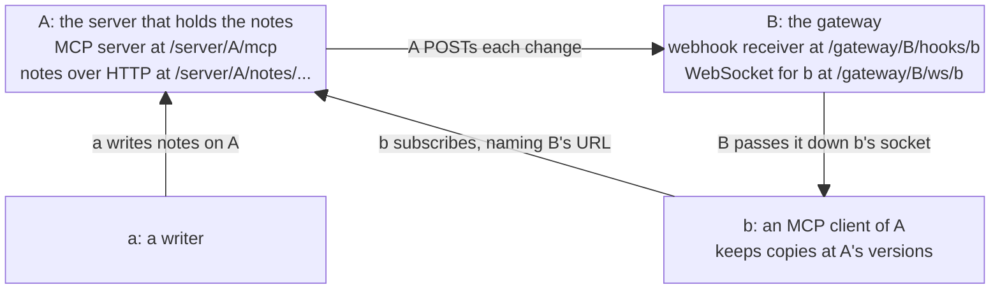

# Resource webhooks, standalone

**Status:** Pass 1 draft, revised 2026-10-22, for Larry's read. The design has two levels, demoed in order. The first delivers today's resource notification over SEP-3415's Events unchanged, as its Open Question 2 sketches it. The second syncs resource state through two methods of this extension's own, with SEP-3415's webhook delivery rules taken by reference. The scope is resources rather than state in general, and leaves polling out of this extension, for now (Larry, 2026-10-20). The requirements the second level implies are numbered in [sep-notes.md](../sep-notes.md). Phases come after Stage 1, and may move into a build child then.

## Objective

**Learn how best to build on MCP's core, its extensions API and SEP-3415, toward a specification in which an MCP client subscribes to some state (a resource), or a collection of them, with a webhook URL, and from then on the server POSTs to that webhook whenever one of them changes, carrying the resource's latest version, a patch to get to the latest version, or a notification that the resource has changed.**

"Best" in the sentence above is a weighted value judgement, trading off technical feasibility, implementation elegance, and political viability to a potential sponsor, the core committee, and the MCP community at large.

**A prototype comes first because building is how we learn.** Some questions surface only when you try to implement. So where the design could raise one, as collections, catching up after a gap and resources outside `https` all could, the prototype takes it on rather than deferring it, and each answer it finds lands in `sep-notes.md`.

## Context

### Timing and political considerations

- **Peter expects watching state to need an API of its own.** Replying to Larry on the SEP-3415 thread on 2026-10-16, he wrote that watching state and consuming messages "will need different handling and different APIs", while likely sharing much of the same machinery.
- **Peter prefers extending an existing mechanism to adding a parallel one.** Asked on 2026-10-23 whether Events could move its notifications to a method of its own, `events/listen`, he called that "unnecessarily messy and inconsistent", and asked instead that SEP-3371 let extensions add to `subscriptions/listen`. This extension's `resources/webhooks/subscribe` sits beside `events/subscribe` in the same way, so the preference counts for the flavor that extends Events when the drafts are compared. It is no reason to change course now, since the standalone flavor is the easiest to build first.
- **The working group is now Tasks and Events** (Peter, in Discord on 2026-10-21). The Agents working group becomes an interest group, its Tasks work folds in, and Luca Chang and Caitie McCaffrey join Clare Liguori and Peter as leads, "to allow us to figure how these things interact". Task state, the subject of Open Question 6, and resource state, this work's, now sit with one group.
- **SEP-3415 takes nothing new while its vote is pending.** Peter, in Discord on 2026-10-20: it is already judged big. The core maintainers may ask for changes after their review, which could give us another chance to comment on SEP-3415 itself.
- **Meanwhile, we start engaging the working group with a PR of a document, not code,** to `modelcontextprotocol/experimental-ext-triggers-events`, opened once this prototype has taught us enough, so the group can comment on what we learned. A SEP follows it.
- **An Extensions Track SEP needs a reference implementation in an official SDK before review** (SEP-2133). This prototype is independent of the SDK, so that implementation comes later, probably built on Peter's TypeScript Events work.
- **This is one of three possible flavors that we've identified so far.** The other two, extending Events and amending it, may follow, and the drafts are compared before one is recommended. The predecessor, `../mcp-events-prototype`, designed a state contract over Events' own methods, and its task files are this repo's mining source.

### Technical

- **SEP-3415 defines Events for discrete messages, and its Open Question 2 is the floor for resources.** It asks whether resource subscriptions should be re-expressed as events, with "a reserved `mcp.resource.updated` event type whose arguments are `{uri}`", so that today's notification gains "cursors, poll and webhook delivery, and replay for free". Nothing in the sketch carries a value or a version. It is today's notification, moved onto Events' delivery, which this design calls the `notify` form.
- **Open Question 6 and Peter's comment open the way to more.** Open Question 6 sketches `mcp.task.updated` with the payload `{status, progress?, result?}`, so a task's state, result included, travels in the event. Peter's comment of 2026-10-16 calls resources and task state the same thing, "observing task state vs stream of messages", needing different handling. Going past Open Question 2's sketch, to deliveries that carry the value or a patch, answers that opening. We prove it on resources first, because a resource already has a URI and contents, where tasks bring in the Tasks extension.
- **Today a resource watcher needs an open stream.** `notifications/resources/updated` arrives only on a `subscriptions/listen` stream, since SEP-2575 replaced `resources/subscribe` with that stream's `resourceSubscriptions` filter. A change made while the stream is down is lost without a trace. Revisions 2025-03-26 to 2025-11-25 let a client resume an SSE stream with `Last-Event-ID`, but 2026-07-28 dropped that, and its server keeps no subscription state across reconnections. The notification also names only the URI, so acting on it takes another round trip via `resources/read`.
- **Others are asking for the same pieces:**
  - SEP-3119 put the new contents in the notification. It was closed without a decision on 2026-09-22, and redirected to a working group first.
  - ext-tasks #24 asks for the current state on reconnect, for tasks.
  - The Filesystems working group's strawman (`experimental-ext-filesystems` #2) gives every resource an opaque `version`.
  - triggers-events #9 reports deliveries that are abandoned after their retries and lost without a signal.

The sections that follow say what makes this worth building, then show the first level end to end: MCP core as it is, plain HTTP, and `notify` over Events. The second level comes after it, on the same cast, followed by collections, who may subscribe, and resources outside `https`. This round's subscriber is a client behind a gateway, the deployment most MCP clients need, since few can receive a webhook.

## Goals

1. **Show a simple `notify` form of resources working on top of SEP-3415's Events, cleanly.** This is not an important goal on its own. It comes first because it is the floor for Open Question 2.
2. **The most important goal is to learn whether resource sync can be built elegantly without conflicting with Events.** Narrowing, elaborating, and extending Events in the ways it is meant to be extended are all expected. The aim is to break no requirement of Events, and where that proves impossible, or merely inelegant, to record it loudly in `sep-notes.md` § *Departures from SEP-3415*.
3. **Both levels build cleanly on MCP's extensions API,** the SDK extension points SEP-3371 proposes. The Filesystems working group has already reported one gap there: an extension's handlers cannot publish resource change events. On SEP-3415's thread, Felix Weinberger has since proposed opening `subscriptions/listen`'s filter to extensions, keyed by extension identifier, with SEP-3371 requiring SDKs to let an extension publish to the streams that opted in (2026-10-23).
4. **A watcher hears about a change without holding a connection open.** Today it learns of one only while its `subscriptions/listen` stream is up.
5. **A missed delivery costs nothing once the next one arrives, and at most one refresh interval if none does.** Today a watcher that misses a notification cannot tell, and has nothing to catch up from.
6. **A delivery can carry the change itself.** Today a change takes two calls: the notification, which carries only the URI, and a `resources/read`.
7. **Webhooks work exactly as SEP-3415 defines them.** MCP keeps one webhook mechanism, an off-the-shelf Standard Webhooks verifier checks every delivery, and an SDK reuses its Events webhook code.
8. **It stays small.** The measure is how many requirements in `sep-notes.md` are this extension's own rather than references to SEP-3415.

## Relationships

- **Gated by nothing.** The prototype and its notes can proceed now.
- **Gates the PR** to `modelcontextprotocol/experimental-ext-triggers-events`, from the fork in `../experimental-ext-triggers-events` on its `resource-webhooks` branch.
- **Gates the official-SDK reference implementation,** in `../mcp-typescript-sdk`.
- **Gates the comparison** with the flavors that extend or amend Events.

## Current state

The predecessor, `../mcp-events-prototype`, never got as far as code, only design, in a few files including a detailed Pass 1 task file. Once we are happy with this repo's design, a mining pass over the predecessor decides each piece's final fate, but this draft already carries a number of items from it:

- the `Note` type, the tools `write_note` and `delete_note`, and the Worker's URL scheme
- the Events server that level 1 needs: `events/list`, `events/subscribe` and webhook delivery as SEP-3415 defines them
- the predecessor's peers, relabeled. Its `b`, which held the notes, is now the server `A`, and its writing browser page is now `a`. Its `a`, which watched `b` and kept copies, has no counterpart this round: B is a gateway, and the client `b` behind it keeps the copies.
- the table of ways to reach a resource, and the plain-HTTP straw man with ETags as versions
- the forms `notify`, `full` and `patch`, and a delivery that names its own form
- coalescing to the newest version, and catching up from a version the client names
- a deletion delivered as a `notify` entry with `deleted: true`, with the subscription carrying on
- in option (b) of open question 1, a change cursor that falls back to the whole collection when it is too old to serve

## Design intent

### Two levels on one cast

- **Level 1, the floor, is `notify` over Events, as Open Question 2 sketches it.** It uses SEP-3415's own methods and an event type named `mcp.resource.updated`, and adds nothing to either. It needs nothing from `sep-notes.md`.
- **Level 2 is resource state sync, in this extension's own methods.** It keeps the cast, the gateway and SEP-3415's webhook rules, and changes what a delivery carries and how a subscriber catches up. Every requirement in `sep-notes.md` is for this level.
- **The demo runs them in that order,** so the second is always seen against the first. Between them, the page's Wipe button empties A, B and `b`, so level 2 starts from a clean slate, with nothing carried over from level 1 (Larry, 2026-10-23).

### The cast

Four parties: a server and a gateway defined in one Worker project, and two clients running on the user's own machine, each in a browser or in some other runtime, a "script".



- **Changes flow from `a` to A to B to `b`:**
  - **From `a` up to A by any means a server offers:** an MCP tool call, an HTTP `PUT` or `POST`, a file write, stdio. The demo starts with A's `write_note` tool, and adds `PUT` later.
  - **From A across to B by webhook:** an Events occurrence at level 1, and at level 2 a change in one of three forms, `notify`, `full` and `patch`.
  - **From B down to `b` by a channel neither SEP specifies:** a WebSocket here, though stdio, a CLI or anything else would do.
- **`b` subscribes with A directly, which is SEP-3415's forward-proxy deployment.** `b` calls A, naming B's webhook URL as the place to deliver, since in SEP-3415 "the callback URL does not need to be the client itself". This example hosts B in the same Worker project as A, which a real forward-proxy deployment would not.
- **The Worker** at `https://resource-webhooks-standalone.transformation.workers.dev` hosts both A and B, and `...` stands for it in the examples. Each later flavor of this SEP, if we build them, gets a Worker project of its own, named after its repo, so each deploys alone. The name waits on the first deploy.
- **A and B are Durable Object classes of their own, `Server` and `Gateway`.** Each composes a module that holds its role, so the Lumenize port can compose the same modules into a Lumenize node, as Lumenize composes its `ClientGateway` into the scoped node that hosts it.
- **We copy `routeDORequest` into this repo.** The Worker routes a request by its path, `/server/{instance}/...` or `/gateway/{instance}/...`, with `routeDORequest`. That is copied in from `@lumenize/routing`: six files, about 790 lines, with its `@lumenize/debug` logging removed, relicensed under Apache-2.0 and listed in `ATTRIBUTIONS.md`.
- **A holds notes and lists.** Its one resource template is `.../server/A/{type}/{folder}/{id}`, with the types `notes` and `lists`. Each resource is an `https` resource, such as `.../server/A/notes/inbox/note-42`, which a client can read with `resources/read` or a plain `GET`, and which carries an `ETag` per version. Notes change through A's tools, `write_note` and `delete_note`, or by `PUT` and `DELETE` on their URLs. A also runs the authorization server that `b` gets its token from.
- **B is a gateway, and stores nothing.** It receives webhooks for each of its clients at a URL of that client's own, `/gateway/B/hooks/{client}`, the path shape SEP-3415's own examples use, and passes each one down that client's WebSocket. Each socket carries its client's secret in its attachment, so B writes nothing, as Lumenize's Gateway writes nothing. B never calls A, and holds no principal there.
  - **SEP-3415 calls this party a gateway,** in its Appendix A, where the SDK "registers it … with the gateway", and calls the deployment a forward proxy. Lumenize's Gateway also carries a client's calls up to the nodes. This one carries only deliveries down, since `b` calls A itself.
  - **Nothing in B knows about notes,** and the same gateway serves both levels, since an Events occurrence and a level-2 change arrive with the same headers, signatures and verification.
- **`b` is an MCP client of A that cannot receive a webhook,** as Claude Code on a laptop or a browser tab cannot. It holds the token, subscribes, refreshes, and keeps a copy of each resource it watches, at A's version. It can be a script in the early phases, but for the demo it runs in the browser, so its own messages are recorded where the demo shows them.
- **The demo shows every message, and what each party holds.** `a` and `b` run in the browser, so their records are local to the page. A and B run on Cloudflare, so they report their contents and the messages they send and receive to the page via a WebSocket back channel.
- **The page has two controls of its own, outside both SEPs,** sent to A and B over the same back channel: the Wipe button, which empties all four parties between the levels, and A's retry schedule, shown on screen.
- **Versions behave as HTTP's `ETag`s do.** Clients compare them only for equality. A's versions need not sort in time, though they may, and a server that knows its own versions sort MAY rely on that inside its implementation. In the examples they are short strings, `v5` and `v6`.

```ts
interface Note { title: string; done?: boolean; due?: string; }
```

### The leg between the gateway and its client

Neither SEP-3415 nor this extension says how a gateway reaches its client. SEP-3415 says only that the endpoint passes on what it receives "by whatever channel it uses". This prototype uses a WebSocket, since Durable Objects hold them cheaply. Stdio, or anything else that carries a message each way, would do.

1. **`b` registers its secret first, on every connection,** with `{"secret": "whsec_..."}`, and B keeps it in the socket's attachment while the socket is open. The secret has to reach B before `b` subscribes, because A's verification challenge arrives at B while A is still handling the subscribe call. B answers that challenge itself, at once, from the secret it holds, without asking `b`.
2. **B passes on each delivery whose signature verifies, and answers A straight away.** A send on a WebSocket does not wait for `b`, so B holds nothing while it answers. While `b`'s socket is closed, B answers `503`, one of the retryable answers SEP-3415 names for a receiver that is not ready.
3. **B tracks nothing else.** A client that reconnects refreshes each of its subscriptions, so B never needs to know what it missed.
4. **Who may connect is B's own business,** as it is any gateway's. The socket's path, `/gateway/B/ws/b`, names the client, as Lumenize's Gateway takes a client's id from its path. A's notes are open to anyone who gets a token, so in this prototype a random id that `b` mints for itself is enough. A gateway for private data would check a credential of its own before it accepted a socket.

### Four ways to reach a resource

| | MCP core, 2026-07-28 | Plain HTTP | Events, with Open Question 2's type | This extension |
|---|---|---|---|---|
| **Write** | `tools/call` on a tool the server offers, such as `write_note` | `PUT` on the resource's URL, and `DELETE` | (none) | (none) |
| **Read** | `resources/read` | `GET` on the resource's URL | (none) | (none: a client reads with `resources/read` or `GET`, though a `full` subscription's result also carries the contents) |
| **Poll for changes** | `resources/read` on a cadence, which returns the whole contents every time, with nothing to say whether they changed | a conditional `GET` with `If-None-Match`, answered `304 Not Modified` when nothing changed | `events/poll` with a cursor | (none, for now) |
| **Be told of changes** | `notifications/resources/updated` on an open `subscriptions/listen` stream, naming only the URI | (none) | a webhook POST naming the URI | a webhook POST with the new version, and the contents or a patch if asked for |

Level 1 takes the first three columns, in Scenarios 1a, 1b and 2. Level 2 takes the last, from Scenario 3 on.

### Level 1: `notify` over Events

#### Scenario 1a: MCP core as it is

`a` writes a note through A's tool, since MCP resources have no write method, and `b` reads it:

```jsonc
// a → A, POST /server/A/mcp
{ "jsonrpc": "2.0", "id": 3, "method": "tools/call",
  "params": { "name": "write_note",
    "arguments": { "uri": ".../server/A/notes/inbox/note-42",
                   "note": { "title": "Buy milk" } } } }

// b → A, POST /server/A/mcp
{ "jsonrpc": "2.0", "id": 4, "method": "resources/read",
  "params": { "uri": ".../server/A/notes/inbox/note-42" } }
// A → b
{ "resultType": "complete",
  "contents": [ { "uri": ".../server/A/notes/inbox/note-42",
                  "mimeType": "application/json",
                  "text": "{\"title\":\"Buy milk\"}" } ],
  "ttlMs": 0, "cacheScope": "public" }      // read again whenever it matters
```

- **Nothing in the result names a version,** so `b` cannot tell whether a later read returns the same note or a new one without comparing contents.
- **To hear about the next change, `b` would hold a `subscriptions/listen` stream open** with the note in its `resourceSubscriptions`. Holding a stream is what this work avoids, so the demo skips it.

#### Scenario 1b: polling with plain HTTP

This scenario uses no MCP at all. It shows what an `https` resource can do already, and where versions come from. `a` writes, and any client polls.

```http
GET /server/A/notes/inbox/note-42           → 200, ETag: "v5"
                                              {"title":"Buy milk"}
GET /server/A/notes/inbox/note-42           → 304 Not Modified
If-None-Match: "v5"
PUT /server/A/notes/inbox/note-42           → 200, ETag: "v6"   (a, the writer)
If-Match: "v5"
{"title":"Buy milk","done":true}
GET /server/A/notes/inbox/note-42           → 200, ETag: "v6"
If-None-Match: "v5"                           {"title":"Buy milk","done":true}
```

- **A version is the resource's strong `ETag`,** written without its quotes: `v6` on the wire of this extension, `"v6"` in an HTTP header.
- **Polling is solved for `https` resources,** which is why this extension leaves polling out, for now. Without some way to push, it either polls often or learns late.

#### Scenario 2: `mcp.resource.updated` over Events

A lists the type in `events/list`, as Open Question 2 sketches it, carrying in `data` what today's notification carries, the URI:

```jsonc
{ "name": "mcp.resource.updated",
  "description": "A resource changed",
  "delivery": ["poll", "webhook"],
  "inputSchema": { "type": "object", "required": ["uri"],
                   "properties": { "uri": { "type": "string" } } },
  "payloadSchema": { "type": "object", "required": ["uri"],
                     "properties": { "uri": { "type": "string" } } } }
```

`b` registers a secret with B, as § *The leg between the gateway and its client* says, then subscribes with SEP-3415's own method:

```jsonc
// b → A, POST /server/A/mcp
{ "jsonrpc": "2.0", "id": 5, "method": "events/subscribe",
  "params": {
    "name": "mcp.resource.updated",
    "arguments": { "uri": ".../server/A/notes/inbox/note-42" },
    "delivery": { "mode": "webhook", "url": ".../gateway/B/hooks/b",
                  "secret": "whsec_<base64 of 32 random bytes>" },
    "cursor": null,                       // start from now
    "ttlMs": 3600000 } }
// A → b, after SEP-3415's verification handshake with B
{ "resultType": "complete", "id": "sub_7c2e91d04ab35f68",
  "refreshBefore": "2026-10-21T15:00:00Z",
  "cursor": "cursor_0041", "truncated": false }
```

`a` marks the note done through `write_note`. A POSTs an ordinary occurrence to B, with SEP-3415's signed headers, and B passes it down `b`'s socket:

```jsonc
{ "eventId": "evt_0042", "name": "mcp.resource.updated",
  "timestamp": "2026-10-21T14:05:00Z",
  "data": { "uri": ".../server/A/notes/inbox/note-42" },
  "cursor": "cursor_0042" }
```

`b` then reads the note with `resources/read`, as in Scenario 1a.

- **Nothing here is new.** It is SEP-3415's methods and webhook rules, an event type named as Open Question 2 sketches it, and B acting as SEP-3415's forward proxy. That is Goal 1.
- **Each change costs two round trips,** the notification and the read, and the notification says only that something changed.
- **Catching up after an absence depends on A keeping its history of events.** SEP-3415 replays from `b`'s cursor when the type "is backed by a durable upstream". Otherwise delivery restarts from now, and `b` cannot tell what it missed. A replay also sends every change, though `b` needs only the latest of each note.

Level 2 removes those last two costs.

### Level 2: resource state sync

#### Only the newest version matters

A resource is state, and a watcher wants to hold its newest version, not to witness every change. This is perhaps the biggest mental model difference from the Events SEP. Three edits while a receiver is down leave it needing only the third. These things follow:

- **The server may coalesce.** A delivery still pending when a newer version lands is replaced by it, and a lost delivery is repaired by the next one.
- **A version is not a cursor.** A version names a state of one resource, and is compared only for equality, as an `ETag` is. A cursor names a position in an order of changes. One resource needs only versions. Whether a collection needs a change cursor is open question 1, and a cursor for paging is open question 2.
- **The server never stores a delivery position per subscription.** It does not record which version each subscriber last acknowledged (Larry, 2026-10-21). On a Durable Object, writes are the most expensive operation: with 1000 subscriptions, recording acknowledgements would turn one write per change into 1000. A subscription's record is written when it is created and when it is refreshed. Other services that sync state over webhooks work the same way: Dropbox, Google Drive and Calendar, Gmail and Microsoft Graph keep no delivery position per subscriber, call their pushes lossy, and leave catching up to the client.
- **Retry queue status per subscription is kept in memory, not storage.** For each subscription and URI, A holds the pending version and its attempts so far, and coalescing keeps that to one entry. Retries are bounded as SEP-3415 bounds them, a few attempts with backoff over no more than 10 to 15 minutes, which puts them with Slack's and Dropbox's short retries. Timers keep a Durable Object alive that long at compatibility dates from 2026-10-01, as Lumenize measured, so retries need no alarm and no write. A delivery whose retries run out, or that an eviction or restart drops, is repaired at the subscriber's next refresh. A webhook POST wakes a hibernating gateway, so B rarely misses one. A client behind a gateway that sleeps and wakes misses more, and catches up by refreshing when it reconnects. The retry schedule is a setting of A's: SEP-3415's bounds by default, and in the demo three attempts at 2, 4 and 8 seconds, so the audience sees a retry, and a newer version replacing a pending one, as they happen.
- **A refresh is the catch-up.** A refresh is the subscribe call made again with the same target and webhook URL. SEP-3415 asks for one before a grant runs out, and a subscriber may make one whenever it may have missed something. It is neither a push nor a read. Its result names the resource's current version, and in the `full` form carries the contents when the subscriber's version is behind, so one call repairs any number of misses. Scenario 5 shows a routine one.

#### Scenario 3: a first subscription, from nothing

The demo's Wipe empties A, B and `b`, and `a` writes note-42 again, as `v1`. The examples' versions restart at `v1` to stay easy to follow, where real ones are opaque and never repeat. `b` connects to B at `wss://.../gateway/B/ws/b`, registers a secret, and subscribes in the `full` form, holding nothing:

```jsonc
// b → B, first, over b's WebSocket: this prototype's own message
{ "secret": "whsec_<base64 of 32 random bytes>" }

// b → A, POST /server/A/mcp
{ "jsonrpc": "2.0", "id": 7, "method": "resources/webhooks/subscribe",
  "params": {
    "uri": ".../server/A/notes/inbox/note-42",
    "form": "full",            // the contents in each delivery; notify if omitted
    "delivery": {
      "url": ".../gateway/B/hooks/b",       // B's URL for b, not b's own
      "secret": "whsec_<the same secret>" },
    "ttlMs": 3600000 } }       // no version: b holds none yet
```

Before answering, A verifies that the webhook URL wants deliveries, by SEP-3415's handshake. It POSTs `{"type":"verification","challenge":"<nonce>"}` to B, signed with `b`'s secret. B checks the signature against the secret `b` registered, and echoes the challenge.

```jsonc
// A → b, the result
{ "resultType": "complete",
  "id": "sub_a3f1c8e2b0d49f7e",              // stable for (principal, url, uri)
  "refreshBefore": "2026-10-21T15:00:00Z",   // the grant; refresh before it
  "version": "v1",
  "contents": [ { "uri": ".../server/A/notes/inbox/note-42",
                  "mimeType": "application/json",
                  "text": "{\"title\":\"Buy milk\"}" } ] }
```

- **The result is `b`'s first copy.** It names `v1` and carries the contents, so one call both subscribes and reads. In level 1, `b` subscribed and then read, and the read named no version.
- **`b` holds nothing until this result arrives,** which is why its request names no version.

#### Scenario 4: a change it hears about

`a` marks the note done, making `v2`. A POSTs to B:

```http
POST /gateway/B/hooks/b
Content-Type: application/json
webhook-id: chg_9c41e0d2
webhook-timestamp: 1792591500
webhook-signature: v1,<base64 HMAC-SHA256 over id, timestamp and body>
X-MCP-Subscription-Id: sub_a3f1c8e2b0d49f7e

{"uri":".../server/A/notes/inbox/note-42","form":"full","version":"v2",
 "contents":[{"uri":".../server/A/notes/inbox/note-42",
   "mimeType":"application/json","text":"{\"title\":\"Buy milk\",\"done\":true}"}]}
```

B verifies the signature, passes the body down `b`'s socket as it was, then answers `200`, and `b` replaces its copy with `v2`.

- **The headers and the signature are SEP-3415's,** so B checks them with an off-the-shelf Standard Webhooks verifier. `webhook-id` is the same for every attempt at one URI and version, so a receiver that deduplicates on it drops repeats.
- **B answers only after passing the delivery on,** as SEP-3415 asks an endpoint to accept a delivery only once it has persisted or forwarded it.
- **In the default `notify` form, the same delivery carries only the version,** as `{"uri": ..., "form": "notify", "version": "v2"}`, and `b` fetches the note when it wants it, with `If-None-Match: "v1"`. That is one field more than level 1's occurrence, and the field lets `b` skip a read whenever the version is one it already holds, which makes every delivery safe to repeat.

#### Scenario 5: a refresh before the grant runs out

A refresh is the same subscribe call, made again with the same `uri` and `delivery.url`. SEP-3415 asks a subscriber to make it before `refreshBefore`, and the grant then starts again. It may also change the form and rotate the secret. `b` names the version it holds:

```jsonc
// b → A, at 14:20, before the 15:00 grant runs out
"params": { "uri": ".../server/A/notes/inbox/note-42", "form": "full",
            "version": "v2",
            "delivery": { "url": ".../gateway/B/hooks/b", "secret": "whsec_..." } }
// A → b
{ "resultType": "complete", "id": "sub_a3f1c8e2b0d49f7e",
  "refreshBefore": "2026-10-21T15:20:00Z",
  "version": "v2" }                          // equal to b's: no contents, no news
```

- **A refresh is neither a push nor a read.** It is the subscriber's own call, it extends the subscription, and its result says what is current, with the contents only when the subscriber's version is behind. Scenario 7 shows that case.
- **A subscriber may refresh whenever it suspects it missed something,** not only when a grant is running out. `b` refreshes every subscription when it reconnects to B.

#### Scenario 6: changes it never sees

`b`'s laptop sleeps and its socket to B closes, so B answers `503` for it, while `a` makes two edits:

| Time | What happens at A | What A sends to B |
|---|---|---|
| 14:30:00 | an edit makes `v3` | a delivery of `v3`, answered `503` |
| 14:30:30 | an edit makes `v4` | nothing: `v4` replaces the pending `v3` |
| 14:31:00 | the first retry | a delivery of `v4`, answered `503` |
| 14:34:00 | `b` is back, and the second retry | a delivery of `v4`, which B passes on and answers `200` |

```jsonc
// the body that succeeds at 14:34:00
{ "uri": ".../server/A/notes/inbox/note-42", "form": "full", "version": "v4",
  "contents": [ { "uri": ".../server/A/notes/inbox/note-42",
                  "mimeType": "application/json",
                  "text": "{\"title\":\"Buy oat milk\",\"done\":true}" } ] }
```

- **`v3` never reaches `b`, and nothing is lost,** because `v4` is everything `b` needs.
- **In the demo, the retries come seconds apart,** not minutes, as § *Only the newest version matters* says, so the audience watches `v4` replace `v3`.
- **Contents travel only when a subscriber asks for them.** SEP-3415's § *Payload minimality* says a server SHOULD keep payloads minimal, and `notify`, the default form, is. `b` asked for `full`, which a server need not offer.
- **A keeps at most one delivery in flight per subscription and URI,** and retries only the newest version. Deliveries for a URI therefore arrive in version order, and a stale one can never overtake a newer one.
- **`contents` has the shape of `resources/read`'s result,** so the code that applies a read applies a delivery.

#### Scenario 7: an absence longer than the retries

`b` stays away past A's retry window, and A abandons the delivery of `v5`. When `b` wakes, it reconnects to B, registers its secret again, and refreshes, naming the version it still holds:

```jsonc
// b → A: the refresh on reconnecting
"params": { "uri": ".../server/A/notes/inbox/note-42", "form": "full",
            "version": "v4", ... }
// A → b
{ "resultType": "complete", "id": "sub_a3f1c8e2b0d49f7e",
  "refreshBefore": "2026-10-21T16:30:00Z",
  "version": "v5",                          // differs from b's v4: b is behind
  "contents": [ { "...": "the note at v5" } ],
  "deliveryStatus": { "active": true,       // retries ran out; not suspended
                      "lastError": "http_5xx",
                      "lastDeliveryAt": "2026-10-21T14:34:00Z" } }
```

- **A refresh is the catch-up,** and it goes straight from A to `b`, not through B. However much `b` missed, this one call brings it to the current version, where level 1 needed A's history of events to replay.
- **`deliveryStatus` is SEP-3415's.** Here it reports the failed attempts at `v5`, with delivery still active, since retries running out is not a suspension.

#### What a receiver's answer means

What each answer means is SEP-3415's. This extension adds two things: a body too large for the `full` form goes in the `notify` form, and a newer version replaces a pending one.

| B answers | What A does |
|---|---|
| any `2xx` | The version is accepted. A drops it from its pending entry. |
| `410 Gone` | A stops retrying that version. The subscription is unaffected, so a later version is delivered as usual. |
| `413 Payload Too Large` | A stops retrying that version. In the `full` form, A sends a body that large in the `notify` form instead, so this answer should never come. |
| any other status, such as `503` while `b` is away, or no answer within about 5 seconds | A retries with backoff, and a newer version that lands meanwhile replaces the pending one. |

#### Scenario 8: a deletion

`a` deletes note-42, through `delete_note`. A delivers, and B passes on:

```jsonc
{ "uri": ".../server/A/notes/inbox/note-42", "form": "notify", "deleted": true }
```

- **Every form delivers a deletion this way,** with no version and no contents. `b` deletes its copy, and a read of the note now fails.
- **The subscription carries on,** since a write can create the note again. Its next version, say `v6`, is delivered like any other. A subscriber that wants no more deliveries unsubscribes with the same `uri` and `delivery.url`.

#### Collections

Collections are where an implementation will teach the most, so the prototype takes them on now. MCP's own rules give the starting point:

- **A subscription already covers sub-resources.** The schema says the URI in `notifications/resources/updated` "might be a sub-resource of the one that the client actually subscribed to".
- **A read can return a collection.** `resources/read` MAY return several entries in `contents`, each with its own `uri`, as when a directory is read.
- **A resource covered by a template need not be listed.** `resources/list` returns the resources available to the client, and nothing ties it to `resources/templates/list`. The spec's own example template, `file:///{path}`, would not list every file.

So a subscription names one of three targets:

```jsonc
{ "uri": ".../server/A/notes" }                   // the notes folder, all under it
{ "uriTemplate": ".../server/A/{type}/archive" }  // each archive, all under it
{ "listed": true }                              // all that resources/list returns
```

##### Scenario 9: a folder

`b` subscribes to A's notes folder in the `notify` form, holding none of it yet:

```jsonc
"params": { "uri": ".../server/A/notes", "form": "notify",
            "delivery": { "url": ".../gateway/B/hooks/b", "secret": "whsec_..." } }
// A → b
{ "resultType": "complete", "id": "sub_5d02e7a9c1b84f36",
  "refreshBefore": "2026-10-21T15:00:00Z" }   // what else: open question 1
```

`a` creates note-43 in the inbox, and A delivers it through B like any change, naming the sub-resource:

```jsonc
{ "uri": ".../server/A/notes/inbox/note-43", "form": "notify", "version": "v1" }
```

- **A new member is a change from nothing,** and a removed one is a deletion, so a collection subscription needs no list-changed signal of its own.
- **Catching up is the open part.** For one resource, the version a subscriber names on a refresh is enough. For a collection, `b` needs to learn which members changed while it was away, and which were deleted. Open questions 1 and 2 take that up.

#### Who may subscribe

**Subscribing requires an authenticated principal, as SEP-3415 does, and permission to read every resource the target covers.** A call that fails either is refused with `Forbidden`, as SEP-3415 refuses it. The principal comes from MCP's own OAuth flow, so every MCP client already knows how to get one. Here it is `b`, which holds the token. B never calls A. Level 1 follows the same rule, since it is SEP-3415's.

- **The prototype's authorization server verifies no identity,** as the authorization server in front of Peter's reference server does. A client registers at `/register`, approves a consent page, and exchanges the code with PKCE for a token. Anyone can get a token, so access to the notes stays open, but each client is its own principal, and no caller can unsubscribe another or replace its secret.
- **Endpoint verification is cached per `(principal, delivery.url, delivery.secret)`.** SEP-3415 caches it per `(principal, url)`. A principal that once verified a webhook URL could then subscribe it again with a secret the receiver never held, skip the handshake, and flood it with deliveries it can only reject. Keyed by the secret, a new secret faces a new handshake, which the receiver fails unless it holds that secret. Rotating a secret costs one handshake, and subscribing the same webhook URL to many targets with one secret costs none.

#### Resources without an `https` URI, in a later phase

Many MCP resources use `file://`, `git://` or a scheme of their own, and a client reads them with `resources/read`, which carries no version today, as Scenario 1a shows. In a phase after the `https` one, each entry of a read's `contents` carries its version in `_meta`, under a key to be agreed with the Filesystems working group, whose strawman gives each resource a `version` too:

```jsonc
{ "contents": [ { "uri": "file:///project/notes.md", "mimeType": "text/markdown",
                  "text": "...", "_meta": { "<agreed key>": "v12" } } ] }
```

A `notify` delivery then tells the client to read, and the read's version tells it whether it got the delivered version or a later one.

#### The `patch` form, in a later phase

For a resource whose contents are JSON, a delivery can carry an RFC 7396 merge patch in place of the whole value. The patch goes from the resource's previous version to its new one, and names both.

- **A assumes `b` holds the previous version.** It has no record of what `b` acknowledged, by the rule in § *Only the newest version matters*, so it cannot patch from anything else.
- **`b` applies a patch only when it holds the version the patch starts from.** When it does not, because a delivery was missed, `b` refreshes, and the `full` form's refresh result brings it the current contents.
- **The predecessor designed the rest in detail,** and the mining pass brings its rules across.

#### What the extension adds to the wire

Everything about delivering a webhook is SEP-3415's. The extension adds two methods, their parameters and results, and the body a change delivers, written in the spec's style. The `patch` form adds a variant to `ResourceChange` in its phase.

```ts
type SubscriptionTarget =
  | { uri: string }                     // the resource and all under it
  | { uriTemplate: string }             // each match, and all under it
  | { listed: true };                   // every resource resources/list returns
type ResourceWebhookSubscribeParams = SubscriptionTarget & {
  form?: "notify" | "full";             // notify when omitted
  version?: string;                     // a uri target's version the client holds
  delivery: { url: string; secret: string };
  ttlMs?: number | null;                // as SEP-3415's events/subscribe
};
interface ResourceWebhookSubscribeResult {
  id: string;
  refreshBefore: string | null;
  version?: string;                     // a uri target's current version
  contents?: ResourceContents[];        // full form, if the version differs
  deliveryStatus?: DeliveryStatus;      // as SEP-3415 defines it
  // A collection's catch-up adds fields here: open question 1.
}
type ResourceWebhookUnsubscribeParams = SubscriptionTarget & {
  delivery: { url: string };
};
type ResourceChange = { uri: string } & (
  | { form: "notify"; version: string }
  | { form: "notify"; deleted: true }
  | { form: "full"; version: string; contents: ResourceContents[] }
);
```

#### What it takes from SEP-3415, and what it replaces

- **Taken by reference, from § *Webhook-Based Delivery*:**
  - the TTL and refresh rules
  - the forward-proxy deployment, in which the webhook URL belongs to a gateway acting for the client
  - endpoint verification, with the secret added to the key of its cache
  - the Standard Webhooks headers and signature
  - SSRF prevention and the TLS requirement
  - the secret's format and rotation
  - the delivery profile
  - `deliveryStatus`
  - the `verification` and `terminated` envelopes
  - the retry bounds and suspension
  - eager unsubscribe
- **Replaced.** [sep-notes.md](../sep-notes.md) sorts each of these into a plain substitution or a narrowing within the room SEP-3415 leaves. None goes against SEP-3415's text:
  - **The key.** The subscription key is `(principal, delivery.url, target)`: who asked, the webhook URL deliveries go to, and the resource URI, template or `listed` they cover. It identifies a subscription for refresh and unsubscribe, and a server's storage keys subscriptions by it or by the `id` derived from it. A target is one string, compared exactly, so the key needs no canonical form of JSON arguments. The form is not part of it, because it changes only what a delivery carries, so a refresh may change it. A principal that watches one target from two places gives each place its own `delivery.url`, as SEP-3415's example `/hooks/client123` does, and an unsubscribe names the webhook URL of the one it ends.
  - **The subscription `id`** is a keyed hash of the key, so a logged `id` cannot be used to test a guessed principal.
  - **The body.** A `ResourceChange` takes the place of an `EventOccurrence`.
  - **The retry model.** Only the newest version of each URI is retried, with pending versions coalesced, where SEP-3415 retries each event on its own.
  - **No replay, no `gap` envelope and no `truncated` for one resource.** The version a subscriber names on each refresh does their work. Whether a collection needs a cursor is open question 1.
- **Its error codes, reused as SEP-3415 intends.** It calls its five new codes general-purpose, "named for reuse across MCP and are not scoped to events". So this extension answers an undeclared form with `Unsupported`, a refused principal with `Forbidden`, an unsubscribe that matches nothing with `NotFound`, a server limit with `ResourceExhausted`, and a callback that fails verification with `CallbackEndpointError`. An unknown URI is refused with `-32602`, as `resources/read` refuses it.
- **Not used:** `events/list`, `events/poll` and `events/stream`. Level 1 uses Events' methods, and level 2 uses its own.

### What building it should teach us

- **Whether the floor stays floor.** Level 1 could carry a version in its own `data`, which an event type may define. If it did, how much of level 2 would a client still need?
- **What counts as a sub-resource:** one or more path segments beyond the subscribed URI, or whatever the server says.
- **How a template matches a URI.** RFC 6570 defines expanding a template, not matching one. The working rule is that each simple `{name}` matches exactly one path segment.
- **Whether one delivery in flight per URI,** rather than per subscription, keeps a busy collection's deliveries flowing.
- **Whether `listed` should also cover resources that only a template reaches.**
- **What a coalesced patch starts from.** When `v8` replaces a pending `v7`, a patch from `v7` is one `b` cannot apply if it never got `v7`, so `b` refreshes. Whether that is rare enough to accept is what the prototype measures.
- **Whether refreshing on every reconnect is enough** for a client behind a gateway, or B should also say what it could not pass on, as Lumenize's Gateway tells a reconnecting client `subscriptionRequired`.
- **What a merge patch means** when `contents` holds several entries, or a text body whose type is JSON.
- **Whether an extension's handlers can publish resource changes** through the SDK extension points SEP-3371 proposes, the gap the Filesystems working group reported, and whether Felix's opening of `subscriptions/listen` to extensions closes it.

## Constraints

- **MCP 2026-07-28's `schema.ts` is the only schema.** `ResourceContents` and its kinds are reused from it, and runtime validation is derived from its TypeScript types, as CLAUDE.md sets out.
- **SEP-3415's text is cited at the PR's head commit, 2ec39b9,** so a later revision cannot change the meaning of either level unnoticed.
- **SEP-2133 binds the extension:** Apache-2.0, Extensions Track, and an official-SDK reference implementation before review.
- **Cloudflare Workers and Durable Objects host the prototype,** under `critical.md`'s rules for storage, secrets and `compatibility_date`.

## Future state

- ⚠️ Design consideration: **a webhook delivery SEP of its own.** Once a second extension takes SEP-3415's webhook delivery by reference, the delivery rules might be better in a SEP that both build on. The first sign is that SEP-3415 reserves its webhook header and well-known paths for Events, though this extension reuses them with the same meanings. Not proposed now (Larry, 2026-10-21).
- ⚠️ Design consideration: **delivery over a client's open stream.** If Felix's `extensions` member on `subscriptions/listen`'s filter lands, level 2 could also deliver over that stream, under this extension's identifier, to a client that holds one, without departing from SEP-3371. Until then, this extension stays off that stream.
- **Tasks.** Open Question 6 and ext-tasks #24 ask for the same thing on task state, and a task exposed as a resource gets level 2 unchanged.
- **A mirror,** where a subscriber keeps copies at the server's versions and serves them to readers of its own, as the predecessor designed. This round covers a client behind a gateway instead.
- **The other two flavors,** and the Lumenize port, whose notes stay in the predecessor's `tasks/lumenize-port.md`.

## Open questions

1. **How does a subscription to a collection catch up after a gap?** `b` was away past A's retries, and it needs to learn which members changed or were deleted meanwhile.
   - **(a) The whole member list.** The collection has a version, and when `b`'s differs, the refresh result lists every current member's `uri` and `version`. A deleted member shows by its absence. Nothing needs an order, but every catch-up costs as much as the collection is big.
   - **(b) Changes since a cursor.** Each delivery and each refresh result carries a cursor: a position in the order of the collection's changes. A refresh naming `b`'s cursor returns only the members changed since, deletions included. A needs one order across the collection's changes and a memory of its deletions, and answers a cursor older than that memory with (a). This is the predecessor's positions, horizon and `truncated`, carried.
   - **(c) Versions that sort.** If every version in a collection came from one ordered counter, "changed since version X" would need no second value, as Kubernetes' `resourceVersion` and etcd's revisions work. But an `https` resource's version is its `ETag`, which nothing can require to sort, and the predecessor's Lumenize notes record how per-resource timestamps fail as one order.
   - **Recommendation:** (b), with (a) as its fallback. It is the dominant pattern for syncing state over webhooks: Dropbox's `cursor`, Drive's `pageToken`, Calendar's `syncToken`, Gmail's `historyId` and Graph's `deltaLink` are each a change cursor the client holds, and each service answers one too old for its history with a reset. A server MAY make a cursor and a version one value, as Kubernetes does, but a client never relies on that. The same request without a webhook would be a poll for collections, which this extension leaves out for now, so the prototype should also say whether a collection needs one.
   - **The reset is not a `410`.** Calendar, Graph and Kubernetes answer a stale cursor with HTTP `410 Gone`, but SEP-3415 gives a receiver's `410` to mean "stop retrying this delivery". This extension's reset would be a field in the refresh result, so that `410` keeps one meaning.
2. **Do catch-up responses page, and with which cursor?** A cursor over a stream of changes is a position in time, so paging through one returns changes in order. A cursor over a listing, as `resources/list` pages, is a position in the listing, with no order in time.
   - **Under (b) of question 1, the change cursor pages too.** A response carries as many changes as fit, says whether more remain, and its cursor resumes there, as `events/poll` does with `hasMore`.
   - **Under (a), or (b)'s fallback, a member list pages** with a listing cursor, as `resources/list` does.
   - **Recommendation:** decide it with question 1. Under (b), one cursor does both jobs while A remembers enough, and a listing cursor serves only the fallback.
3. **What are the names?** The extension identifier `io.modelcontextprotocol/resource-webhooks`, the methods `resources/webhooks/subscribe` and `resources/webhooks/unsubscribe`, and the target `listed`.
   - **The methods' prefix:** `resources/` belongs to the core specification, and an extension may need a prefix of its own, as SEP-3415 reserves `events/`.
   - **Recommendation:** keep these names, and ask about the prefix in the PR.

## Decisions

| Decision | Rejected alternative — why |
|---|---|
| The design has two levels, demoed in order: `notify` over Events as Open Question 2 sketches it, then resource state sync in this extension's own methods (Larry, 2026-10-22) | State sync on Events' methods too: that is the flavor that extends Events, kept for the later comparison. Going straight to state sync: it skips the floor a sponsor can accept without argument, and the baseline the second level is measured against. |
| The floor is Open Question 2 as written, and level 2 answers what Open Question 6 and Peter's comment of 2026-10-16 opened, proved on resources first (Larry, 2026-10-22) | Presenting state sync as the answer to Open Question 2: its sketch carries only a URI, so the claim would overreach. Starting with tasks: they bring in the Tasks extension, where a resource already has a URI and contents. |
| Level 2 starts from a clean slate: the demo's Wipe button empties A, B and `b` after level 1 (Larry, 2026-10-23) | Carrying `b`'s copy over from level 1: level 1's read names no version, so `b` would hold a version it never learned, and the line between notification and state sync would blur. |
| The demo writes through A's `write_note` tool first, and adds `PUT` later (Larry, 2026-10-22) | `PUT` first: plain HTTP is not MCP, and the floor should be MCP end to end. |
| The standalone flavor is built first, with its own methods and SEP-3415's webhook rules taken by reference (Larry, 2026-10-20) | Extending or amending Events first: both ride `events/*` and override its rules for a type. The standalone flavor overrides nothing, and is the easiest to build. |
| Resources, not state in general (Larry, 2026-10-20) | A general state contract: it needs a key, a value type and a way to offer it on any event type, all new vocabulary, where a resource already has a URI and contents. |
| This round's subscriber is a client behind a gateway: `b` subscribes with A directly, naming B's webhook URL, and B passes each delivery down `b`'s WebSocket (Larry, 2026-10-21) | A mirror, where B subscribes and serves copies to `b`: further from SEP-3415's forward-proxy deployment and from Lumenize's Gateway, and it leaves out the case most MCP clients are in, unable to receive a webhook. Both at once: twice the cast before either has run. |
| The server and the gateway are Durable Object classes of their own, `Server` and `Gateway`, each composing a module for its role (Larry, 2026-10-21) | One class for both: it blurs the line SEP-3415 draws between a server and a webhook endpoint, suggests that a server hosts its clients' gateways, carries storage the gateway never uses, and ties the gateway to the notes so it could not also receive deliveries from an Events server. Keeping the name `Peer` for A: nothing in this round is a peer. |
| The leg between the gateway and its client is a WebSocket in this prototype, and outside both SEPs (Larry, 2026-10-21) | Specifying it: SEP-3415 leaves the channel to the endpoint, and stdio or anything else that carries a message each way would serve. |
| This extension leaves polling out, for now (Larry, 2026-10-20) | A poll method: an `https` resource is already polled with a conditional `GET`, and level 1's type can offer `events/poll`. |
| Collections are in scope: a folder, a URI template, or every listed resource (Larry, 2026-10-20) | Deferring them: they raise the questions only an implementation answers, which is what a prototype is for. |
| Subscribing requires an authenticated principal, as SEP-3415 does, from MCP's OAuth flow with an authorization server that verifies no identity, as Peter's reference server has (Larry, 2026-10-20) | Anonymous callers sharing one principal: any of them could unsubscribe another or replace its secret. A login endpoint handing out a random token: the same idea outside the OAuth flow every MCP client already speaks. Requiring the old secret to unsubscribe or rotate: a client that lost its secret could only wait out the TTL, and the secret, held by gateways, would become a credential. |
| Endpoint verification is cached per `(principal, delivery.url, delivery.secret)` (Larry, 2026-10-20) | Per `(principal, url)`, as SEP-3415 does: a principal that verified a webhook URL once could subscribe it again with a secret the receiver never held, and flood it. Per `(url, secret)` alone: two principals holding one secret would share a verification, which SEP-3415 rules out. |
| The server stores no per-subscription record of the version each subscriber acknowledged, and a patch starts from the resource's previous version (Larry, 2026-10-21) | Recording acknowledgements: on a Durable Object, one change watched by 1000 subscriptions would cost 1000 writes instead of one, writes being the most expensive operation, while a refresh on reconnect repairs a miss. No service that syncs state over webhooks records a delivery position per subscriber either. |
| Resources without an `https` URI are in scope, in a later phase, with their version in `resources/read`'s `_meta` (Larry, 2026-10-20) | `https` only: a client could not tell whether a read is newer than a delivery, so every other resource would be left out. |
| The field is `version`, with the semantics of HTTP's `ETag`: compared for equality, never required to sort (Larry, 2026-10-20) | `eTag`, Larry's own preference: the Filesystems strawman already says `version`, and following the group matters more. |
| What this extension suggests for SEP-3415 itself, such as the secret in the verification cache's key and the scope of its reservations, reaches Peter with the PR to the working group's repo, not while SEP-3415 is up for its vote (Larry, 2026-10-21) | Raising them in Discord now: Peter is busy with the vote and the SDK work, Events can still change after acceptance since it is not yet stable, and the PR shows why in context. |
| `form` is optional, and a subscription without one gets `notify` (Larry, 2026-10-21) | A required `form`: one more field for every subscriber to get right. A `full` default: it would put contents in every delivery by default, against SEP-3415's § *Payload minimality*. |
| A repo of its own, Apache-2.0 throughout (Larry, 2026-10-20) | A folder in `mcp-events-prototype`: the name says events, and a new repo keeps the predecessor's files untouched until mining. |
| The SEP starts as numbered MUST, SHOULD and MAY notes beside the prototype (Larry, 2026-10-20) | Drafting the SEP first: the prototype's design leads, and the notes become the SEP's Specification and its conformance traceability. |
